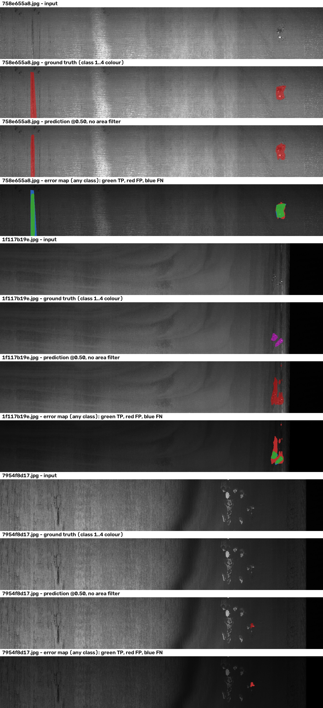

# Steel Defect Segmentation

Four-class multi-label semantic segmentation of hot-rolled steel surfaces
(Severstal), built as a **controlled-experiment project**: one baseline, two
ablations, a threshold and connected-component study, a frozen held-out
evaluation, and an ONNX deployment path with parity checks.

The headline number is deliberately unflattering: **test macro Dice 0.2375** with
**31.83%** normal-image false-alarm rate. Two classes are effectively undetected.
This repository documents that result honestly and explains, with measurements,
why the obvious fixes (Dice loss, class-aware sampling) did **not** produce a
deployable model.

| | Validation (1,881) | Independent test (1,895) |
|---|---:|---:|
| Macro Dice | 0.249202 | **0.237482** |
| Normal-image false-positive rate | 34.01% | **31.83%** |
| Dice class 1 / 2 / 3 / 4 | 0.042 / 0.027 / 0.520 / 0.407 | 0.036 / 0.020 / 0.526 / 0.369 |

---

## 1. Project Overview

### The problem

A steel mill inspects rolled sheet for surface defects. Each image is a
`256x1600` grayscale strip; four defect classes may appear, independently and
simultaneously, and most strips are clean (46.96%). Two operational costs
compete: missing a defect (scrap ships) and flagging a clean strip (line stops
for nothing). A model that maximises pixel overlap alone is not useful — the
false-alarm rate has to be part of the objective.

### What this repository contains

- A segmentation stack: RLE codec, immutable original-image splits, dataset and
  synchronised patch transforms, tiled full-image inference.
- A `14.27 M`-parameter ResNet18-style U-Net trained from scratch, returning raw
  `[B,4,H,W]` logits.
- Three training arms (E0/E1/E2) sharing data, seed, optimiser and schedule so
  that exactly one variable changes per comparison.
- Two post-hoc studies: an 18-point threshold sweep and a 7-point
  connected-component area sweep, both validation-only.
- A one-shot held-out test evaluation executed after every policy was frozen.
- An ONNX export with PyTorch/ONNX Runtime parity checks and latency
  measurements, plus a minimal-dependency inference script.
- 20 unit tests covering RLE, multi-label decoding, loss behaviour, metric
  aggregation, tiling tails and component filtering.

### What it is not

- It is **not** a state-of-the-art detector. Public Severstal solutions reach
  much higher Dice with ImageNet-pretrained encoders, heavier augmentation and
  longer schedules. This project uses a from-scratch encoder on CPU/MPS-class
  hardware and reports what that actually yields.
- It is **not** a tuned submission. The test split was opened once, after
  freezing, and no test number was used to select anything.

### Engineering contributions worth reviewing

1. **Leak-free evaluation protocol.** Splits are made on *original image ids*
   before any patch is cut, so a 512-pixel window from one sheet cannot appear
   in both train and validation. Splits are hashed into every checkpoint and
   verified before evaluation.
2. **Metric aggregation that cannot be gamed.** TP/FP/FN are accumulated over
   the whole split, not averaged per image, so a 1600-pixel image with a
   20-pixel defect cannot outweigh a mostly-empty one.
3. **A negative result with a mechanism.** The Dice term raises minority recall
   (class 1: 2.2% → 25.8%) and destroys precision (85.6% → 11.2%). The
   mechanism — a Dice loss normalised by positive area barely penalises
   single-pixel false positives on clean sheets — is quantified, not asserted.
4. **Deployment parity as a gate, not an afterthought.** The ONNX graph is only
   accepted if the thresholded mask agrees with PyTorch on 100% of pixels;
   logit-level differences are reported separately.

---

## 2. Dataset

[Severstal Steel Defect Detection](https://www.kaggle.com/c/severstal-steel-defect-detection)
(Kaggle, 2019). Labels are run-length-encoded per class, one-indexed,
column-major.

| Property | Value |
|---|---|
| Labelled images used | 12,568 (`train_images/`) |
| Image size | 256 x 1600, grayscale stored as 3-channel JPEG |
| Classes | 4 (crazing, inclusion, patches, pitted surface) |
| Multi-label | Yes — one image may carry several classes; masks are 4 independent binary channels |
| Defect-free images | 5,902 (46.96%) |
| Kaggle `test_images/` (5,506 unlabelled) | Not used anywhere |

| Class | Name | Defective images | Share of defective images | Share of all pixels |
|---:|---|---:|---:|---:|
| 1 | Crazing | 897 | 13.5% | 0.076% |
| 2 | Inclusion | 247 | 3.7% | 0.016% |
| 3 | Patches | 5,150 | 77.2% | 2.55% |
| 4 | Pitted surface | 801 | 12.0% | 0.54% |

Class 2 appears in 247 of 12,568 images and covers 0.016% of pixels — roughly
**one positive pixel in 6,000**. This single fact explains most of Section 5.

### Splits (frozen, immutable)

| Split | Images | Defect-free | C1 | C2 | C3 | C4 |
|---|---:|---:|---:|---:|---:|---:|
| Train | 8,792 | 4,131 | 626 | 170 | 3,602 | 559 |
| Validation | 1,881 | 885 | 133 | 36 | 770 | 119 |
| Test (held out) | 1,895 | 886 | 138 | 41 | 778 | 123 |

- Strategy: 4-bit multi-label stratification, seed 42, 70/15/15.
- Cross-split duplicate image ids: **0** (verified by `scripts/audit_data.py`).
- Manifests are committed under `data/processed/splits/` and hashed
  (`train` `ba7887…`, `val` `593cf5…`, `test` `79ebfd…`). Every checkpoint
  stores the hashes it was trained with; evaluation scripts refuse to run on a
  mismatch.

### Getting the data

The dataset is **not** in this repository (~1.6 GB) and must be downloaded from
Kaggle under its own terms. See [Quick Start](#9-installation-and-quick-start).

---

## 3. Model Architecture

A U-Net with a ResNet18-style encoder, implemented in `src/steel_defect_segmentation/model.py`
without a `torchvision` dependency.

```text
input 3x256x512
  stem   7x7/2 conv, BN, ReLU                      ->  64 x 128 x 256
  l1     2 x BasicBlock(64)                        ->  64 x 128 x 256
  l2     2 x BasicBlock(128, stride 2)             -> 128 x  64 x 128
  l3     2 x BasicBlock(256, stride 2)             -> 256 x  32 x  64
  l4     2 x BasicBlock(512, stride 2)             -> 512 x  16 x  32
  d3     upsample + concat(l3) + 2x conv           -> 256 x  32 x  64
  d2     upsample + concat(l2) + 2x conv           -> 128 x  64 x 128
  d1     upsample + concat(l1) + 2x conv           ->  64 x 128 x 256
  head   1x1 conv                                  ->   4 x 256 x 512  (raw logits)
```

| Decision | Choice | Reason |
|---|---|---|
| Parameters | 14,274,244 | Fits comfortably in MPS unified memory at batch 4 |
| Pretraining | **None** | No ImageNet weights are downloaded; the project runs fully offline. Inputs are therefore scaled to `[0,1]` with **no** ImageNet mean/std — introducing those constants without pretrained weights would only hurt. |
| Activation | Raw logits | `BCEWithLogitsLoss` is numerically stable; sigmoid is applied only where probabilities are needed. Inference threshold 0.50 is exactly `logit >= 0`. |
| Multi-label head | 4 independent channels | Classes co-occur; no softmax, no mutual exclusion |
| Upsampling | Bilinear + `align_corners=False` | Matches the ONNX export exactly, and is what PyTorch/ORT agree on |
| Loss (E0) | `BCEWithLogitsLoss` | The baseline: per-pixel, class-independent |

The encoder mirrors ResNet18's stage layout but does not import it. That is a
deliberate trade: a from-scratch encoder is weaker, but the repository installs
and trains with no external weight download, which matters for an offline,
reproducible demo.

---

## 4. Training Methodology

| Setting | Value |
|---|---|
| Optimiser | AdamW |
| Learning rate | `3e-4`, constant (no scheduler decay in E0/E1) |
| Weight decay | `1e-5` |
| Batch size | 4 |
| Sampling (E0/E1) | Random `256x512` crop from a full `256x1600` image |
| Epochs | <= 30, early stop after 6 epochs without improvement |
| Early-stop monitor | Full-image validation BCE (tiles stitched, then loss) |
| Device | Apple Silicon MPS, CPU fallback |
| Seed | 42 |
| E0 wall clock | 41,234 s (11.5 h) for 24 epochs |

**Checkpoint selection.** Every epoch is evaluated on all 1,881 validation
originals at full resolution; the checkpoint with the best full-image macro Dice
is kept (`best_macro_dice.pt`), alongside `best_val_loss.pt` and `last.pt`.
Ties keep the earlier epoch, so a plateau cannot silently drift to a later
checkpoint.

**Why full-image validation every epoch.** Cropped-patch metrics are cheap but
misleading here: a `256x512` crop of a `256x1600` strip often contains no
defect, and the crop-level false-positive rate is unrelated to the per-sheet
false-alarm rate that production cares about. The cost is ~1,600 s/epoch; the
benefit is that every number in Section 6 is measured the way it will be used.

**Artifacts per run.** `metrics.jsonl` (one record per epoch, including TP/FP/FN
and probability histograms), `run.log`, `config.yaml`, `manifest_hashes.json`,
`best_*.pt`, `last.pt` (model + optimiser + scheduler + early-stopping state +
RNG state, so `--resume` is exact).

---

## 5. Experiments and Ablation Studies

Full per-epoch tables, threshold grids and component sweeps: **[docs/EXPERIMENTS.md](docs/EXPERIMENTS.md)**.

| Arm | Change (one variable) | Best val macro Dice | Normal FPR | Verdict |
|---|---|---:|---:|---|
| **E0** | BCE only, random crops | **0.249202** (ep 24) | **34.01%** | **Selected** |
| E1 | `+ 1.0 x SoftDiceLoss` | 0.255518 (ep 14) | 70.28% | Rejected: FPR +36 pts |
| E2 | Class-aware sampling, BCE | 0.318016 (ep 20) | 46.33% | Rejected: FPR +12 pts |
| E2 (in-constraint) | E2 best epoch with FPR <= 34.01% | 0.161653 (ep 13) | 30.73% | Worse than E0 |

### Finding 1 — the baseline is a "high-precision, near-silent" detector

E0 achieves precision 0.86 / 0.96 on classes 1 / 2 but recall 0.022 / 0.014.
It is not failing to localise *something*; it is declining to commit on
sparse, low-contrast defects because BCE is dominated by the 99.9% background.
Classes 1 and 2 sit at Dice 0.0000 for the first 13 epochs (see
`docs/EXPERIMENTS.md`), then emerge abruptly — a signature of a decision
boundary crossing rather than gradual learning.

### Finding 2 — Dice loss buys recall with false alarms, and cannot be rescued by thresholding

Adding a Soft Dice term does what the literature says: class 1 recall
`0.022 -> 0.258`, class 2 `0.014 -> 0.124`, macro Dice `0.2492 -> 0.2555`.
It also drops class 1 precision `0.856 -> 0.112` and lifts the normal-image
false-alarm rate to **70.28%**.

The threshold sweep shows this is not a threshold problem: at 0.95, where E0 is
down to 0.79% FPR, E1 is still at **49.83%**. The Dice term changes the model's
probability calibration, not just its operating point.

The mechanism: Dice is normalised by positive area, so a handful of stray
pixels on a clean sheet costs almost nothing inside a batch that also contains a
large true defect, while BCE — the only term that penalises those pixels — keeps
its original weight. Re-weighting `dice_weight`, or adding a per-image
false-positive term, is the obvious next experiment; it was not run here.

### Finding 3 — better sampling raises the average and the false-alarm rate together

Class-aware sampling (inverse-sqrt rare-class weighting, source-image cap of 3
draws/epoch, normal/positive strata preserved) produces the best macro Dice of
the project, **0.318016**, and the first usable class 2 Dice (0.141). Its FPR is
**46.33%** — the extra positives it learned to emit on rare defects are also
emitted on clean steel. Inside the 34.01% constraint, E2's best epoch is 13 at
Dice 0.1617, i.e. clearly worse than E0.

**Conclusion.** With a fixed architecture, a fixed 30-epoch budget and no
pretraining, macro Dice and false-alarm rate trade against each other along a
frontier, and none of the three arms moves the frontier — they slide along it.
A real improvement needs better features (pretrained encoder, more context),
not a different loss on the same features.

### Post-hoc studies

- **Threshold sweep** (18 values, 0.10–0.95, validation only): E0 is monotone —
  each +0.05 threshold buys ~5–6 points of FPR for ~0.03 macro Dice. The 0.50
  point used in training was kept; no threshold was tuned on test.
- **Connected-component filtering** (`8`-connected, minimum area 0/8/…/256):
  on clean sheets E0 emits 1,974 false-positive components, 78.3% smaller than
  256 px. Filtering at 256 cuts FPR `34.01% -> 21.24%` at a Dice cost of only
  `0.2492 -> 0.2408` — a genuinely useful deployment knob, but it lowers
  class-1 recall (`0.0218 -> 0.0110`) so it was **not** adopted in the frozen
  policy. For E1 the same filter cannot help: 2,040 of its clean-sheet false
  positives are already >= 256 px.

---

## 6. Quantitative Results

### Validation (1,881 images, threshold 0.50, no area filter)

| Model / checkpoint | Epoch | Macro Dice | Normal FPR | All-background | Dice 1 | Dice 2 | Dice 3 | Dice 4 |
|---|---:|---:|---:|---:|---:|---:|---:|---:|
| E0 best macro | 24 | 0.249202 | 34.01% | 35.19% | 0.0425 | 0.0272 | 0.5200 | 0.4072 |
| E1 best macro | 14 | 0.255518 | 70.28% | 17.01% | 0.1557 | 0.0656 | 0.5715 | 0.2292 |
| E2 best macro | 20 | 0.318016 | 46.33% | 29.56% | 0.0687 | 0.1412 | 0.6404 | 0.4218 |


*Each marker is one threshold from the 18-point sweep. The dashed line is the
E0 reference false-alarm rate (34.01%) used as the deployment constraint.*

### Independent test (1,895 images, evaluated once)

| Images | Normal images | False-alarmed normal images | Macro Dice | Normal FPR | All-background |
|---:|---:|---:|---:|---:|---:|
| 1,895 | 886 | 282 | **0.237482** | **31.83%** | 34.93% |

| Class | Dice | IoU | Precision | Recall | TP | FP | FN |
|---:|---:|---:|---:|---:|---:|---:|---:|
| 1 Crazing | 0.035566 | 0.018105 | 0.791709 | 0.018192 | 10,981 | 2,889 | 592,648 |
| 2 Inclusion | 0.019721 | 0.009959 | 0.770201 | 0.009989 | 1,344 | 401 | 133,210 |
| 3 Patches | 0.525921 | 0.356780 | 0.770041 | 0.399326 | 7,634,762 | 2,279,986 | 11,484,340 |
| 4 Pitted surface | 0.368721 | 0.226032 | 0.548654 | 0.277661 | 1,143,336 | 940,556 | 2,974,409 |

ONNX Runtime CPU, tiled inference: 886.8 s for 1,895 images (~0.47 s/image).

**Reading these numbers.** Test macro Dice is 4.7% relative below validation and
test FPR is slightly better, so checkpoint selection did not visibly overfit the
validation split. But the absolute picture is poor: class 3 (~80% of all defect
pixels) is detected at Dice 0.53, while classes 1 and 2 are effectively
undetected despite precisions of 0.79 / 0.77 — the model fires on a few pixels
it is confident about and misses the rest. **A third of clean strips would stop
the line.** This is a research prototype, not a deployable inspector.

### Metric definitions (so the numbers are reproducible to the digit)

- Dice per class: `2TP / (2TP + FP + FN)` with TP/FP/FN summed over the entire
  split, not averaged per image.
- Macro Dice: unweighted mean over the 4 classes. Classes 1 and 2 therefore
  carry 25% of the score each, despite covering 0.08% of pixels — which is why
  macro Dice is small and volatile.
- Normal-image FPR: fraction of the 886/885 defect-free images with at least one
  positive pixel in any class.
- All-background: fraction of images where the model predicts nothing at all.

---

## 7. Qualitative Visualizations



Generated by `examples/visualize_predictions.py` from the frozen ONNX model and
official RLE ground truth — no synthetic predictions, no retouching. Rows are
`input / ground truth / prediction @0.50 / error map`; in the error map green is
true positive, red false positive, blue false negative (union over classes).

| Case | What it shows |
|---|---|
| `758e655a8` (row 1) | The typical success: a class-3 patch is found with Dice 0.866. This is roughly the ceiling of the current model. |
| `1f117b19e` (row 2) | **Class confusion.** The model localises the defect almost exactly (predicted x-range 1341–1404 vs ground-truth 1342–1402) but assigns it to class 3 while the label says class 1. Class-1 Dice is 0.000 for this image even though the pixels are found. Severstal labels are known to be noisy, so part of this is label ambiguity — but it means the reported class-1 Dice understates localisation ability while overstating class separability. |
| `7954f8d17` (row 3) | **A clean-sheet false alarm.** No ground truth, 311 predicted class-3 pixels on a faint scratch — exactly the failure mode behind the 31.83% FPR. |

Per-class error dumps from the test run are archived in
`reports/final-delivery/test_error_cases/` (12 images: TP/FP/FN for each class).

---

## 8. ONNX Inference

### Frozen inference contract

| Item | Value |
|---|---|
| Input | `image`, float32 `[1, 3, 256, 512]`, RGB, scaled `uint8 / 255` |
| Output | `logits`, float32 `[1, 4, 256, 512]`, **no activation** |
| Threshold | 0.50 (equivalent to `logit >= 0`) |
| Post-processing | None (minimum component area = 0) |
| Tiling | `256x512` windows, stride `256x384`, right/bottom tail included, overlapping **logits averaged before thresholding** |
| Graph | opset 17, 54.45 MiB, SHA-256 `27938b3c…4ffe` |

### Parity with PyTorch

| Check | Result |
|---|---|
| Synthetic tile, max abs logit error | 3.05e-05 |
| Synthetic tile, threshold-mask agreement | **100.000000%** |
| Synthetic `256x1600` stitched, max abs error | 2.48e-05 |
| Synthetic `256x1600` stitched, mask agreement | **100.000000%** |
| 8 frozen validation images, max abs error | 1.98e-04 |
| 8 frozen validation images, min mask agreement | **100.000000%** |

Mask agreement is the deployment-relevant number: logits differ in the 4th–5th
decimal from different fusion orders, but no pixel crosses the decision
boundary.

### Latency (Apple M4, synthetic input)

| Backend | Model only P50 / P95 | Full `256x1600` image P50 / P95 |
|---|---:|---:|
| ONNX Runtime CPU | 69.05 / 71.42 ms | 302.58 / 313.75 ms |
| PyTorch MPS | 28.77 / 31.11 ms | 130.56 / 152.18 ms |
| ONNX Runtime CoreML (+ CPU fallback) | 15.69 / 16.64 ms | 68.99 / 73.14 ms |

Full-image numbers include scaling, tiling, inference, overlap averaging and
thresholding, excluding disk I/O. The CoreML execution provider falls back to
CPU for part of the graph, so it is not a pure-CoreML measurement.

### Run it

```bash
# single image or a directory
python scripts/infer_final.py path/to/image_or_dir \
  --output predictions/ \
  --model reports/final-delivery/e0_epoch24_best_macro.onnx \
  --provider cpu
```

Writes four binary class masks (`*_class_{1..4}_mask.png`) and one colour
overlay (`*_overlay.jpg`) per input image.

---

## 9. Installation and Quick Start

### Requirements

| File | Contents | Use |
|---|---|---|
| `requirements.txt` | numpy, opencv, pandas, PyYAML, matplotlib, torch | data, training, evaluation |
| `requirements-inference.txt` | numpy, opencv, PyYAML, onnx, onnxruntime | deployment (no PyTorch) |
| `requirements-dev.txt` | base + pytest | tests |
| `requirements-deploy.txt` | pinned `onnx` / `onnxruntime` | referenced by the inference and export paths |

Python 3.10+. Verified on Python 3.13.5, NumPy 2.5.4, PyTorch 2.14.1,
ONNX Runtime 1.31.0, OpenCV 5.0.0.

### Install and test

```bash
git clone https://github.com/yanan-ji/steel-defect-segmentation.git
cd steel-defect-segmentation
python3 -m venv .venv && source .venv/bin/activate
pip install -r requirements-dev.txt
pytest -q            # 20 passed
```

`pytest.ini` puts `src/` on the path, so no editable install is required.
`pip install -e .` also works if you prefer a normal package import.

### Model weights

The exported ONNX graph (54.45 MiB) is published as a **GitHub Release asset**,
not in the Git tree — it is above GitHub's comfortable blob size and would
bloat every clone.

```bash
mkdir -p reports/final-delivery
curl -L -o reports/final-delivery/e0_epoch24_best_macro.onnx \
  https://github.com/yanan-ji/steel-defect-segmentation/releases/download/v1.0.0/e0_epoch24_best_macro.onnx

shasum -a 256 reports/final-delivery/e0_epoch24_best_macro.onnx
# expected: 27938b3ca9a79a9fe5a2e26b881014e32ee8958b36879d1b905b4bd30fab4ffe
```

Alternatively, reproduce it from scratch: train E0 (Section 4, ~11.5 h on M4),
then run `python scripts/export_final_onnx.py`, which re-checks the checkpoint's
manifest hashes before exporting.

### Dataset

```bash
# 1. Accept the competition rules on Kaggle, then download train.zip + train.csv
# 2. Unpack so that this path exists:
#    severstal-steel-defect-detection/{train.csv, train_images/}
# 3. Create splits if you need to regenerate them (the frozen manifests are
#    already committed, so this is optional and will not match them bit-for-bit
#    unless the same library versions are used)
python scripts/create_splits.py --config configs/data.yaml
python scripts/audit_data.py --config configs/data.yaml --visualize 12
```

### Inference

```bash
pip install -r requirements-inference.txt
python scripts/infer_final.py severstal-steel-defect-detection/train_images \
  --output predictions/ --provider cpu
```

### Reproduce the qualitative figure

```bash
python examples/visualize_predictions.py \
  --ids 758e655a8.jpg 1f117b19e.jpg 7954f8d17.jpg \
  --out docs/figures/qualitative_predictions.jpg
```

### Reproduce the experiments (optional, long)

```bash
python scripts/train_e0_formal.py --out reports/baseline-bce-formal        # ~11.5 h
python scripts/train_e0_formal.py --objective bce-dice \
  --out reports/bce-dice-formal                                            # ~9.1 h
python scripts/build_e2_index.py --out reports/class-aware-sampling
python scripts/train_e2_formal.py                                          # ~10.3 h
python scripts/analyze_thresholds.py --out reports/threshold-analysis --device mps
python scripts/analyze_postprocessing.py --out reports/postprocessing-analysis --device mps
python scripts/export_final_onnx.py
python scripts/evaluate_final_test.py     # one-shot; refuse to run twice
```

`evaluate_final_test.py` verifies the checkpoint hash, the ONNX hash, the
manifest hash and the parity gate before it touches a test image, and writes
`test_results.json` only if all of them match. That is why the test number can
be trusted to be a single, uncontaminated measurement.

### Repository layout

```text
src/steel_defect_segmentation/   RLE, labels, splits, dataset, tiling, losses,
                                 metrics, model, sampling, postprocessing
scripts/                         audit, train, analyse, export, evaluate
tests/                           20 unit tests (synthetic data only)
configs/data.yaml                paths, patch size, loader, training knobs
data/processed/splits/           frozen manifests (committed)
docs/figures/                    curated figures used by this README
docs/EXPERIMENTS.md              all per-epoch records
examples/                        qualitative visualisation
reports/                         run artefacts: per-epoch logs, curves,
                                 threshold/area sweeps, final delivery
```

`reports/` contains the real run artefacts, including the original Chinese
reports (`experiment_report.md`) as they were written during the project.
Model weights, ONNX graphs and per-epoch visualisation dumps are excluded by
`.gitignore`.

---

## 10. Limitations and Future Work

### Limitations (stated plainly)

1. **Absolute quality is low.** Macro Dice 0.24 means the model is a weak
   segmenter. It is useful as a controlled testbed, not as an inspector.
2. **Two of four classes are effectively undetected.** Class 1 recall 1.8%,
   class 2 recall 1.0% on test. Any claim of "four-class segmentation" has to be
   read with that in mind.
3. **False-alarm rate is unacceptable for production.** 31.83% of clean strips
   receive at least one positive pixel. Filtering at 256 px brings it to ~21%
   at a Dice cost, still far from usable.
4. **No pretrained encoder.** The largest single lever (ImageNet/self-supervised
   initialisation) was deliberately excluded for offline reproducibility, which
   caps achievable Dice on 8,792 training images.
5. **One global threshold, one resolution.** Per-class thresholds would help
   (class 3 peaks near 0.15–0.25, class 4 near 0.30–0.40), and multi-scale
   inference was not attempted.
6. **Label noise is not modelled.** The class-confusion case in Section 7 looks
   like a labelling disagreement as much as a model error; no label-cleaning or
   noise-robust loss was used.
7. **Single dataset, single seed.** No cross-dataset validation, and each arm was
   trained once — run-to-run variance is unknown, so a 0.006 macro-Dice
   difference between E0 and E1 should not be over-interpreted.
8. **Compute ceiling.** MPS, batch 4, <30 epochs. The learning-rate schedule
   (constant) is a simplification, not a tuned choice.

### What I would do next, in order of expected payoff

1. **Pretrained encoder + ImageNet normalisation** — replace the from-scratch
   stem/stages with a torchvision ResNet18/34 (or ConvNeXt-T) initialised from
   ImageNet, keep the decoder. This is the change most likely to move Dice on
   classes 1–3 by a large margin.
2. **Per-class thresholds with a false-alarm budget** — the sweep data is
   already there; the missing piece is a per-class constrained optimisation
   instead of one global cut.
3. **An explicit false-positive term.** The E1 mechanism analysis says the loss
   needs a term that charges for positives on clean images (e.g. an image-level
   "any-defect" head, or Dice computed with a background channel). Sampling and
   loss re-weighting both failed for this reason.
4. **Higher working resolution / context.** 256-pixel windows may simply not
   carry enough context for crazing; test `512x512` tiles or a full-width
   `256x1600` input with a lighter backbone.
5. **Label-noise handling** — symmetric-loss or co-teaching style training, plus
   a manual audit of the class-1/3 confusions found in Section 7.
6. **More seeds** for the two rejected arms, so the negative results come with
   error bars instead of single runs.

---

## Acknowledgements

Dataset: [Severstal Steel Defect Detection](https://www.kaggle.com/c/severstal-steel-defect-detection),
hosted on Kaggle. Under the competition rules the Competition Data may only be
used for participation and may not be redistributed, so this repository ships
**no** dataset files — only image-ID manifests, aggregate metrics and derived
figures. The RLE convention (one-indexed, column-major) follows the competition
specification. The rendered figures in this repository illustrate model
behaviour and are not a substitute for downloading the data.

## License

Code: see `LICENSE` (MIT). No third-party source code is vendored and **no
pretrained weights are used** — the ResNet18-style encoder is implemented from
scratch in `src/steel_defect_segmentation/model.py`. The only external inputs
are the pip dependencies in `requirements.txt` (PyTorch BSD-3-Clause, OpenCV
Apache-2.0, ONNX Runtime MIT, NumPy/Pandas BSD-3-Clause, PyYAML MIT), each of
which retains its own license. Nothing here is a derivative of those packages'
source.

The released ONNX weights are consequences of training on the Severstal data
and are offered for evaluation and reproduction under the same MIT terms; the
**dataset itself is not covered** by this license — see Acknowledgements.

## Citation

If this repository is useful in your work:

```bibtex
@misc{ji2026steeldefect,
  title  = {Steel Defect Segmentation: a controlled ablation study for four-class
            surface defect segmentation on Severstal},
  author = {Ji, Yanan},
  year   = {2026},
  url    = {https://github.com/yanan-ji/steel-defect-segmentation}
}
```
