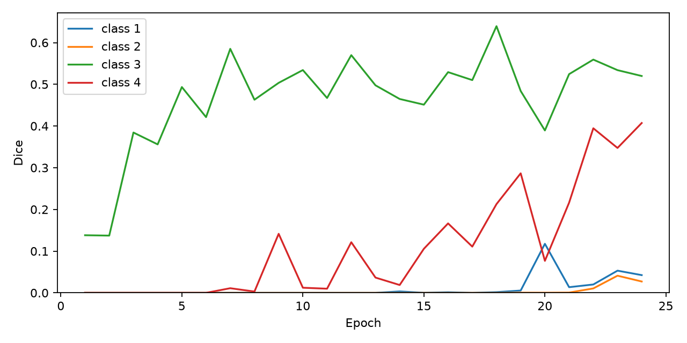
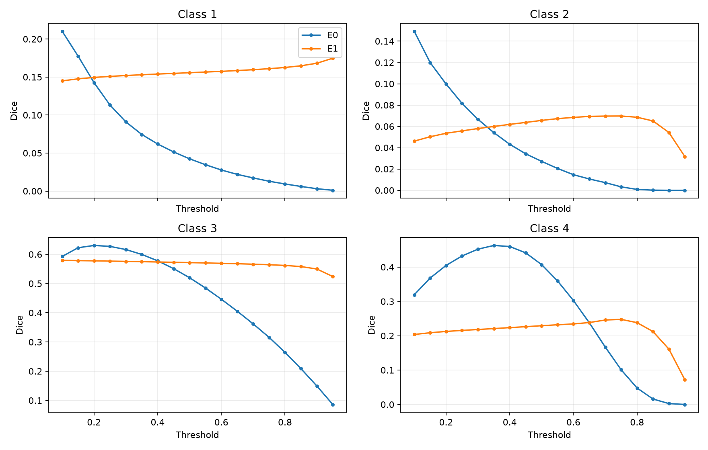

# Experiment records

Every number in this document is copied from artefacts that were produced by the
runs described here and are committed under `reports/`. Nothing was re-trained,
re-tuned or re-scored while preparing this repository. Per-epoch tables were
generated mechanically from `metrics.jsonl` (not transcribed by hand).

| Artefact | Path |
|---|---|
| E0 per-epoch log | `reports/baseline-bce-formal/metrics.jsonl` |
| E1 per-epoch log | `reports/bce-dice-formal/metrics.jsonl` |
| E2 per-epoch log | `reports/class-aware-sampling-formal/epoch1/metrics.jsonl` |
| Threshold sweep (18 values) | `reports/threshold-analysis/` |
| Connected-component sweep | `reports/postprocessing-analysis/` |
| Frozen model identity + parity | `reports/final-delivery/` |

The original run reports are also archived in Chinese (the working language of
the project): `reports/*/experiment_report.md`, `reports/threshold-analysis/report.md`,
`reports/postprocessing-analysis/report.md`, `reports/final-delivery/*.md`.

## Validation protocol

All reported model metrics use the same protocol, and the protocol was fixed
before the first epoch:

- 1,881 validation originals, evaluated at full `256x1600` resolution.
- Tiling `256x512`, stride `256/384`, tail included, overlapping **logits**
  averaged, then sigmoid, then a single global threshold.
- TP/FP/FN accumulated over the whole split before Dice/IoU are computed, so a
  large image contributes proportionally to its pixel count (no per-image mean).
- Macro Dice = unweighted mean over the four classes.
- A class with an empty target and an empty prediction scores 1.0; an empty
  target with a non-empty prediction scores 0.0.
- Normal-image false-positive rate (FPR) = fraction of the 885 defect-free
  validation images that receive at least one positive pixel in any class.
  This is the business-relevant metric: a normal sheet flagged as defective is a
  false alarm.

The test split was not opened until checkpoint, threshold, tiling and ONNX parity
had been frozen. No test number in this document influenced any decision.

---

## E0 — BCE baseline (final model)

`python scripts/train_e0_formal.py --out reports/baseline-bce-formal`

AdamW, constant LR `3e-4`, weight decay `1e-5`, batch 4, random `256x512`
crops, at most 30 epochs, early stopping after 6 consecutive epochs without
improvement in full-image validation BCE. Loss: raw `BCEWithLogitsLoss`.
24 epochs completed in 41,234 s (11.5 h) on Apple Silicon MPS.

| Epoch | Train BCE | Val BCE | Macro Dice | Dice 1 | Dice 2 | Dice 3 | Dice 4 | Normal FPR | Time (s) |
|---:|---:|---:|---:|---:|---:|---:|---:|---:|---:|
| 1 | 0.039197 | 0.029978 | 0.034526 | 0.0000 | 0.0000 | 0.1381 | 0.0000 | 53.79% | 2040.7 |
| 2 | 0.031362 | 0.029512 | 0.034307 | 0.0000 | 0.0000 | 0.1372 | 0.0000 | 14.69% | 2099.3 |
| 3 | 0.028324 | 0.024885 | 0.096099 | 0.0000 | 0.0000 | 0.3844 | 0.0000 | 50.73% | 1672.0 |
| 4 | 0.026381 | 0.025514 | 0.088994 | 0.0000 | 0.0000 | 0.3560 | 0.0000 | 25.20% | 1579.3 |
| 5 | 0.025747 | 0.022026 | 0.123363 | 0.0000 | 0.0000 | 0.4935 | 0.0000 | 31.41% | 1577.5 |
| 6 | 0.024242 | 0.022250 | 0.105331 | 0.0000 | 0.0000 | 0.4213 | 0.0000 | 22.37% | 1585.1 |
| 7 | 0.023419 | 0.019922 | 0.149033 | 0.0000 | 0.0000 | 0.5851 | 0.0111 | 35.59% | 1629.1 |
| 8 | 0.022263 | 0.021886 | 0.116537 | 0.0000 | 0.0000 | 0.4631 | 0.0031 | 49.60% | 1651.9 |
| 9 | 0.022018 | 0.021868 | 0.161247 | 0.0000 | 0.0000 | 0.5035 | 0.1415 | 36.84% | 1651.4 |
| 10 | 0.021545 | 0.020439 | 0.136603 | 0.0000 | 0.0000 | 0.5342 | 0.0122 | 36.95% | 1662.0 |
| 11 | 0.021146 | 0.020771 | 0.119275 | 0.0000 | 0.0000 | 0.4672 | 0.0099 | 17.85% | 1659.5 |
| 12 | 0.020564 | 0.019318 | 0.172829 | 0.0000 | 0.0000 | 0.5699 | 0.1214 | 48.02% | 1814.8 |
| 13 | 0.019840 | 0.019133 | 0.133546 | 0.0000 | 0.0000 | 0.4976 | 0.0366 | 16.72% | 1910.4 |
| 14 | 0.018998 | 0.019535 | 0.121751 | 0.0034 | 0.0000 | 0.4648 | 0.0188 | 22.37% | 1732.1 |
| 15 | 0.019628 | 0.019771 | 0.139255 | 0.0002 | 0.0000 | 0.4512 | 0.1057 | 26.78% | 1650.3 |
| 16 | 0.018947 | 0.019035 | 0.174282 | 0.0015 | 0.0000 | 0.5292 | 0.1665 | 32.99% | 1643.3 |
| 17 | 0.018086 | 0.018451 | 0.155238 | 0.0000 | 0.0000 | 0.5101 | 0.1109 | 21.81% | 1736.7 |
| 18 | 0.018530 | 0.017487 | 0.213449 | 0.0017 | 0.0000 | 0.6394 | 0.2128 | 37.18% | 1900.1 |
| 19 | 0.018050 | 0.020659 | 0.194127 | 0.0055 | 0.0005 | 0.4840 | 0.2866 | 35.93% | 1828.0 |
| 20 | 0.018704 | 0.020327 | 0.145991 | 0.1176 | 0.0003 | 0.3894 | 0.0767 | 29.49% | 1640.8 |
| 21 | 0.017552 | 0.019365 | 0.188703 | 0.0136 | 0.0007 | 0.5244 | 0.2162 | 28.14% | 1641.9 |
| 22 | 0.016969 | 0.017712 | 0.246103 | 0.0200 | 0.0106 | 0.5593 | 0.3946 | 34.24% | 1647.9 |
| 23 | 0.017937 | 0.018178 | 0.243912 | 0.0532 | 0.0411 | 0.5340 | 0.3474 | 29.49% | 1642.9 |
| **24** | **0.017342** | **0.017728** | **0.249202** | **0.0425** | **0.0272** | **0.5200** | **0.4072** | **34.01%** | 1637.5 |

Best validation BCE: epoch 18 (`0.017487`). Best macro Dice: epoch 24
(`0.249202`). Epoch 24 was frozen as the deliverable because the objective is
segmentation quality, not likelihood.

Observations that shaped the rest of the project:

1. Classes 1 and 2 stay at Dice ≈ 0 for the first 13 epochs. They are 7.1% and
   2.0% of defective images and cover 0.076% and 0.016% of pixels, so a
   background-dominated BCE has almost no gradient signal for them.
2. Validation BCE keeps improving after epoch 20 while macro Dice remains
   volatile — the loss is not a proxy for the metric we care about.
3. Normal-image FPR oscillates between 14% and 50% across epochs and only
   settles near 30–35% at the end. Threshold choice, not just training, drives
   the false-alarm rate.

## E1 — BCE + Soft Dice

`python scripts/train_e0_formal.py --objective bce-dice --out reports/bce-dice-formal`

Identical data, seed, optimiser and schedule. Loss becomes
`BCEWithLogitsLoss + 1.0 x SoftDiceLoss`, where the Dice term is averaged only
over classes present in the batch (an all-empty batch contributes a
differentiable zero and BCE keeps the background penalty).
14 epochs in 32,743 s (9.1 h).

| Epoch | Train BCE | Train Dice | Val BCE | Val Dice | Val Total | Macro Dice | Dice 1/2/3/4 | Normal FPR | Time (s) |
|---:|---:|---:|---:|---:|---:|---:|---|---:|---:|
| 1 | 0.063109 | 0.615391 | 0.046044 | 0.358744 | 0.404788 | 0.121000 | 0.0006/0.0000/0.4469/0.0365 | 82.03% | 1811.4 |
| 2 | 0.055637 | 0.520822 | 0.045330 | 0.350009 | 0.395340 | 0.129863 | 0.0041/0.0000/0.4169/0.0985 | 92.77% | 1902.8 |
| 3 | 0.053319 | 0.485041 | 0.051080 | 0.329065 | 0.380145 | 0.161455 | 0.0522/0.0011/0.4796/0.1129 | 96.05% | 1926.0 |
| 4 | 0.052310 | 0.474394 | 0.041208 | 0.275362 | 0.316570 | 0.190515 | 0.0561/0.0140/0.5352/0.1568 | 89.83% | 1876.2 |
| 5 | 0.051782 | 0.456261 | 0.048254 | 0.289801 | 0.338056 | 0.188291 | 0.0592/0.0018/0.5331/0.1591 | 87.91% | 1951.5 |
| 6 | 0.050875 | 0.440799 | 0.043415 | 0.268804 | 0.312219 | 0.196999 | 0.0805/0.0122/0.5243/0.1710 | 87.68% | 2445.9 |
| 7 | 0.050675 | 0.442743 | 0.050982 | 0.279699 | 0.330681 | 0.196322 | 0.0935/0.0133/0.5398/0.1387 | 89.15% | 2860.0 |
| 8 | 0.048281 | 0.403022 | 0.040249 | 0.255876 | 0.296125 | 0.219899 | 0.1082/0.0185/0.5401/0.2128 | 84.63% | 2889.9 |
| 9 | 0.047473 | 0.405296 | 0.042873 | 0.262464 | 0.305337 | 0.226473 | 0.1215/0.0292/0.5641/0.1911 | 89.94% | 2961.0 |
| 10 | 0.045869 | 0.400409 | 0.045351 | 0.328001 | 0.373352 | 0.197971 | 0.0231/0.0465/0.5488/0.1735 | 62.37% | 2515.2 |
| 11 | 0.046633 | 0.398078 | 0.042810 | 0.255787 | 0.298596 | 0.217847 | 0.0708/0.0169/0.5748/0.2089 | 81.69% | 2676.1 |
| 12 | 0.045625 | 0.391702 | 0.053772 | 0.253031 | 0.306803 | 0.232655 | 0.1425/0.0392/0.5798/0.1692 | 85.88% | 2461.1 |
| 13 | 0.043974 | 0.383050 | 0.058482 | 0.228705 | 0.287188 | 0.215409 | 0.0852/0.0498/0.5770/0.1497 | 95.71% | 2338.4 |
| **14** | **0.043285** | **0.359716** | **0.040542** | **0.262776** | **0.303318** | **0.255518** | **0.1557/0.0656/0.5715/0.2292** | **70.28%** | 2128.1 |

Selected checkpoint: epoch 14 (best macro Dice). Early stopping had not fired;
training was stopped at epoch 14 for the comparison window.

This is the central negative result of the project:

- Macro Dice rises `0.2492 -> 0.2555` (+2.5% relative) and minority recall
  improves a lot (class 1 recall `0.0218 -> 0.2581`, class 2 `0.0138 -> 0.1244`),
  which is what the Dice term is supposed to do.
- Normal-image FPR explodes `34.01% -> 70.28%`. Class 1 precision collapses
  `0.8557 -> 0.1115`.
- The Dice term is normalised by the positive area, so a 1-pixel prediction on a
  normal image costs almost nothing inside a batch that also contains real
  defects. BCE was the only term penalising those pixels, and its weight is
  unchanged. The trade is not a free win; it moves the operating point from
  "precise but near-silent" to "sensitive but noisy".

## E2 — class-aware sampling

`python scripts/build_e2_index.py` builds a candidate-tile index from training
labels only, then `python scripts/train_e2_formal.py` trains with a sampler that
(a) keeps the normal-source and candidate-positive strata at their original
counts, (b) upweights rare classes by inverse square-root patch frequency, and
(c) caps any single source image at three draws per epoch. Everything else
(BCE loss, optimiser, schedule, crops) is identical to E0, so the only changed
variable is the sampling distribution.
22 epochs in 37,163 s (10.3 h), early-stopped at epoch 22.

| Epoch | Train BCE | Val BCE | Macro Dice | Dice 1/2/3/4 | Normal FPR | All-background | Stale | Time (s) |
|---:|---:|---:|---:|---|---:|---:|---:|---:|
| 1 | 0.040026 | 0.037801 | 0.002096 | 0.0000/0.0000/0.0084/0.0000 | 15.25% | 80.54% | 0 | 2019.5 |
| 2 | 0.033111 | 0.027479 | 0.073806 | 0.0000/0.0000/0.2952/0.0000 | 60.11% | 28.81% | 0 | 1889.6 |
| 3 | 0.030081 | 0.033012 | 0.106873 | 0.0000/0.0000/0.4275/0.0000 | 78.87% | 17.17% | 1 | 1780.2 |
| 4 | 0.027464 | 0.025880 | 0.118470 | 0.0000/0.0000/0.4739/0.0000 | 54.80% | 34.45% | 0 | 1677.2 |
| 5 | 0.026480 | 0.023604 | 0.113600 | 0.0000/0.0000/0.4544/0.0000 | 22.60% | 57.52% | 0 | 1660.3 |
| 6 | 0.024962 | 0.028448 | 0.037093 | 0.0000/0.0000/0.1484/0.0000 | 2.03% | 76.87% | 1 | 1635.7 |
| 7 | 0.023979 | 0.021477 | 0.130348 | 0.0000/0.0000/0.5132/0.0082 | 22.71% | 54.12% | 0 | 1645.5 |
| 8 | 0.023431 | 0.022248 | 0.113067 | 0.0000/0.0000/0.4522/0.0001 | 33.67% | 43.49% | 1 | 1636.7 |
| 9 | 0.022911 | 0.021332 | 0.139523 | 0.0000/0.0000/0.4702/0.0879 | 42.03% | 39.55% | 0 | 1668.3 |
| 10 | 0.021160 | 0.021962 | 0.163153 | 0.0000/0.0000/0.5800/0.0726 | 50.28% | 32.32% | 1 | 1636.9 |
| 11 | 0.021741 | 0.020368 | 0.154340 | 0.0006/0.0000/0.5206/0.0962 | 38.64% | 37.32% | 0 | 1645.4 |
| 12 | 0.020623 | 0.022682 | 0.196387 | 0.0001/0.0000/0.4719/0.3136 | 34.24% | 43.49% | 1 | 1628.7 |
| 13 | 0.020581 | 0.024887 | 0.161653 | 0.0053/0.0000/0.3261/0.3153 | 30.73% | 42.42% | 2 | 1629.7 |
| 14 | 0.020573 | 0.020331 | 0.134347 | 0.0018/0.0000/0.4804/0.0552 | 38.31% | 37.00% | 0 | 1650.6 |
| 15 | 0.020160 | 0.019875 | 0.166628 | 0.0761/0.0260/0.5430/0.0214 | 43.39% | 31.74% | 0 | 1634.0 |
| 16 | 0.019481 | 0.018221 | 0.218425 | 0.0236/0.0000/0.5920/0.2581 | 56.38% | 24.99% | 0 | 1645.9 |
| 17 | 0.018356 | 0.020177 | 0.211888 | 0.0009/0.0035/0.5873/0.2558 | 46.21% | 32.48% | 1 | 1621.9 |
| 18 | 0.018736 | 0.022981 | 0.149292 | 0.0280/0.0133/0.3787/0.1772 | 17.06% | 53.00% | 2 | 1728.5 |
| 19 | 0.018444 | 0.020208 | 0.247125 | 0.0666/0.1449/0.4347/0.3423 | 35.25% | 36.10% | 3 | 1682.5 |
| **20** | **0.018336** | **0.019030** | **0.318016** | **0.0687/0.1412/0.6404/0.4218** | **46.33%** | 29.56% | 4 | 1717.4 |
| 21 | 0.017378 | 0.021614 | 0.289243 | 0.0895/0.1999/0.5102/0.3573 | 40.00% | 34.61% | 5 | 1663.3 |
| 22 | 0.017940 | 0.020065 | 0.277693 | 0.1239/0.2649/0.4494/0.2726 | 43.50% | 29.29% | 6 | 1665.4 |

E2 reaches the highest validation macro Dice of the three arms (`0.318016`,
+27.6% relative over E0) and the first non-trivial class-2 Dice (`0.1412`), but
its FPR is `46.33%`, above the 34.01% reference ceiling. Inside the ceiling the
best E2 epoch is 13 with macro Dice `0.161653` and FPR `30.73%`, i.e. worse than
E0. **The joint target was not met, and E2 was not adopted.**

This is the second negative result, and the more instructive one: sampling
raises the average over classes, but the extra positives the model learns to
emit on rare classes are also emitted on clean sheets. Macro Dice alone is a
misleading objective for this task.

## Matched three-way comparison

Same 1,881 validation images, same tiling, same 0.50 threshold.

| Model / checkpoint | Epoch | Macro Dice | Normal FPR | All-background | Dice 1 | Dice 2 | Dice 3 | Dice 4 |
|---|---:|---:|---:|---:|---:|---:|---:|---:|
| E0 best macro | 24 | 0.249202 | 34.01% | 35.19% | 0.0425 | 0.0272 | 0.5200 | 0.4072 |
| E1 best macro | 14 | 0.255518 | 70.28% | 17.01% | 0.1557 | 0.0656 | 0.5715 | 0.2292 |
| E2 best macro | 20 | 0.318016 | 46.33% | 29.56% | 0.0687 | 0.1412 | 0.6404 | 0.4218 |
| E2 best within FPR ceiling | 13 | 0.161653 | 30.73% | 42.42% | 0.0053 | 0.0000 | 0.3261 | 0.3153 |

Every E2 epoch is plotted; the dashed line is the E0 FPR reference. Only epochs
below that line are admissible under the deployment constraint, and none of them
beats E0's Dice.

## Threshold sweep (validation only)

`python scripts/analyze_thresholds.py --out reports/threshold-analysis`

Uniform thresholds 0.10–0.95 in steps of 0.05, all 1,881 validation originals,
TP/FP/FN accumulated dataset-wide. E0 = epoch 24 checkpoint,
E1 = epoch 14 checkpoint.

| Threshold | E0 Macro Dice | E0 Normal FPR | E0 All-background | E1 Macro Dice | E1 Normal FPR | E1 All-background |
|---:|---:|---:|---:|---:|---:|---:|
| 0.10 | 0.317889 | 78.76% | 10.42% | 0.243520 | 77.97% | 12.49% |
| 0.15 | 0.321991 | 70.51% | 14.67% | 0.246280 | 76.95% | 13.18% |
| 0.20 | 0.319360 | 63.62% | 18.18% | 0.248299 | 75.93% | 13.77% |
| 0.25 | 0.313555 | 58.53% | 20.79% | 0.249719 | 75.25% | 14.09% |
| 0.30 | 0.306492 | 53.33% | 23.50% | 0.250997 | 73.79% | 14.83% |
| 0.35 | 0.297763 | 48.70% | 26.05% | 0.252159 | 73.33% | 15.15% |
| 0.40 | 0.285641 | 43.28% | 29.08% | 0.253303 | 72.77% | 15.58% |
| 0.45 | 0.269535 | 38.19% | 32.32% | 0.254391 | 71.64% | 16.16% |
| **0.50** | **0.249202** | **34.01%** | **35.19%** | **0.255518** | **70.28%** | **17.01%** |
| 0.55 | 0.224945 | 28.81% | 38.28% | 0.256560 | 69.04% | 17.60% |
| 0.60 | 0.197816 | 25.76% | 40.46% | 0.257359 | 68.02% | 18.13% |
| 0.65 | 0.168879 | 22.15% | 43.01% | 0.258532 | 67.34% | 18.55% |
| 0.70 | 0.138381 | 18.98% | 45.93% | 0.260333 | 66.44% | 18.98% |
| 0.75 | 0.108221 | 14.58% | 49.65% | 0.260683 | 65.08% | 19.67% |
| 0.80 | 0.080626 | 9.27% | 54.17% | 0.257809 | 63.62% | 20.47% |
| 0.85 | 0.057708 | 5.54% | 60.61% | 0.250048 | 61.36% | 21.96% |
| 0.90 | 0.038773 | 1.47% | 69.22% | 0.233325 | 56.84% | 24.35% |
| 0.95 | 0.021815 | 0.79% | 79.90% | 0.200623 | 49.83% | 28.23% |

Conclusions:

- E0 is monotone in the useful range: every 0.05 step up trades roughly 0.03
  macro Dice for 5–6 points of FPR. The operating point is a product decision,
  not an accuracy decision, so 0.50 was kept (it is also the value the training
  loop used, so no extra tuning was introduced).
- E1 **never** gets below 49.8% normal-image FPR, even at 0.95, where E0 is at
  0.79%. The Dice term did not merely shift the operating point, it changed the
  model's probability calibration. A threshold sweep cannot rescue E1.
- E0 at 0.10–0.15 peaks at macro Dice `0.3220` but flags 70–79% of clean
  sheets. Optimising Dice alone would produce an unusable detector.

Per class, the optimum is not shared: class 3 peaks around 0.15–0.25 while class
4 peaks around 0.30–0.40. A single global threshold is a deliberate
simplification; the plot quantifies what it costs.

## Connected-component filtering (validation only)

`python scripts/analyze_postprocessing.py --out reports/postprocessing-analysis`

Pixel threshold fixed at 0.50; every 8-connected per-class region smaller than
`A` pixels is removed, for `A in {0, 8, 16, 32, 64, 128, 256}`.

| Model | Min area | Macro Dice | Normal FPR | Class 1/2/3/4 Dice | Removed px | Removed components |
|---|---:|---:|---:|---|---:|---:|
| E0 | 0 | 0.249202 | 34.01% | 0.0425/0.0272/0.5200/0.4072 | 0 | 0 |
| E0 | 8 | 0.249113 | 32.20% | 0.0424/0.0271/0.5198/0.4071 | 7,968 | 2,315 |
| E0 | 16 | 0.248982 | 31.07% | 0.0423/0.0269/0.5197/0.4071 | 21,225 | 3,514 |
| E0 | 32 | 0.248749 | 29.60% | 0.0418/0.0269/0.5193/0.4070 | 50,123 | 4,782 |
| E0 | 64 | 0.248034 | 26.78% | 0.0396/0.0269/0.5188/0.4068 | 103,798 | 5,957 |
| E0 | 128 | 0.245989 | 24.97% | 0.0359/0.0234/0.5180/0.4067 | 190,749 | 6,915 |
| E0 | 256 | 0.240774 | 21.24% | 0.0218/0.0178/0.5164/0.4071 | 360,147 | 7,829 |
| E1 | 0 | 0.255518 | 70.28% | 0.1557/0.0656/0.5715/0.2292 | 0 | 0 |
| E1 | 64 | 0.257390 | 65.99% | 0.1570/0.0713/0.5715/0.2297 | 133,751 | 5,817 |
| E1 | 128 | 0.260103 | 61.69% | 0.1588/0.0795/0.5716/0.2305 | 322,215 | 7,856 |
| E1 | 256 | 0.263326 | 56.84% | 0.1617/0.0884/0.5715/0.2317 | 715,033 | 9,988 |

Diagnosis:

- On clean sheets E0 produces 1,974 false-positive components. 19.4% are
  smaller than 8 px and 78.3% smaller than 256 px — the false alarms are
  mostly speckle, which is why `A=256` cuts FPR from 34.0% to 21.2% at a cost
  of only 0.008 macro Dice.
- E1 produces 5,524 false-positive components on clean sheets, and 2,040 of
  them are at least 256 px. Filtering cannot remove large blobs, which is why
  E1 stays at 56.8% FPR even at `A=256`.
- Filtering is not free: ground truth has 2,980 defect components and only 4.1%
  are smaller than 256 px, yet class-1 recall still falls `0.0218 -> 0.0110`
  because a fragmented prediction keeps only part of a larger true defect.
- The frozen policy therefore keeps `A=0`. The sweep is kept as a documented
  sensitivity knob for deployments that need a lower false-alarm rate.

## Frozen selection rule

Decided on validation before the test split was opened:

1. Constraint: normal-image FPR no worse than the E0 reference (34.0113%).
2. Objective: maximise macro Dice subject to (1).
3. Tie-break: higher Dice, lower FPR, lower threshold, then E0.

E0 epoch 24 at threshold 0.50 satisfies (1) and is the best point on the
Pareto front that does. E1 fails (1) at every threshold; E2 fails it at its best
epoch and loses to E0 inside the constraint. **E0 epoch 24, threshold 0.50, no
area filter** is the frozen artefact.

## Independent held-out test

Run exactly once, after checkpoint, threshold, preprocessing, tiling and ONNX
parity were frozen. 1,895 images never seen in training or validation.

| Image count | Normal images | Normal images with a false alarm | Macro Dice | Normal FPR | All-background |
|---:|---:|---:|---:|---:|---:|
| 1,895 | 886 | 282 | **0.237482** | **31.83%** | 34.93% |

| Class | Defect | Dice | IoU | Precision | Recall | TP | FP | FN |
|---:|---|---:|---:|---:|---:|---:|---:|---:|
| 1 | crazing | 0.035566 | 0.018105 | 0.791709 | 0.018192 | 10,981 | 2,889 | 592,648 |
| 2 | inclusion | 0.019721 | 0.009959 | 0.770201 | 0.009989 | 1,344 | 401 | 133,210 |
| 3 | patches | 0.525921 | 0.356780 | 0.770041 | 0.399326 | 7,634,762 | 2,279,986 | 11,484,340 |
| 4 | pitted surface | 0.368721 | 0.226032 | 0.548654 | 0.277661 | 1,143,336 | 940,556 | 2,974,409 |

Inference: 886.8 s for 1,895 images on ONNX Runtime CPU (tiled, ~0.47 s/image).

Test macro Dice (`0.237482`) is 4.7% relative lower than validation
(`0.249202`) and normal FPR is slightly better (`31.83%` vs `34.01%`). The gap is
small enough that the validation split is not obviously over-fitted by
checkpoint selection, but the absolute numbers are what they are: this model is
not production-ready, and classes 1 and 2 are effectively undetected
(recall 1.8% and 1.0%).

## ONNX parity and latency

`python scripts/export_final_onnx.py` — export, `onnx.checker`, then PyTorch vs
ONNX Runtime comparison. 8 deterministic validation images (the first 8 of the
frozen validation manifest) plus synthetic inputs. No test image was read.

| Check | Result |
|---|---|
| Synthetic tile max abs logit error | 3.05e-05 |
| Synthetic tile threshold-mask agreement | 100.000000% |
| Synthetic `256x1600` stitched max abs error | 2.48e-05 |
| Synthetic `256x1600` stitched mask agreement | 100.000000% |
| 8 validation images max abs logit error | 1.98e-04 |
| 8 validation images min mask agreement | 100.000000% |

Threshold-mask agreement is the metric that matters for deployment: logits
differ in the 4th–5th decimal because of different fusion orders, but no pixel
crosses the 0.50 boundary.

| Backend | Model only P50 / P95 (ms) | Full `256x1600` image P50 / P95 (ms) |
|---|---:|---:|
| ONNX Runtime CPU | 69.05 / 71.42 | 302.58 / 313.75 |
| PyTorch MPS | 28.77 / 31.11 | 130.56 / 152.18 |
| ONNX Runtime CoreML (+ CPU fallback) | 15.69 / 16.64 | 68.99 / 73.14 |

Measured on Apple M4 with synthetic inputs, 20 warm-up-free repeated runs after
warm-up; end-to-end numbers include scaling, tiling, inference, overlap
averaging and thresholding but exclude disk I/O. The CoreML provider falls back
to CPU for some ops, so these numbers are not a pure-CoreML measurement.
