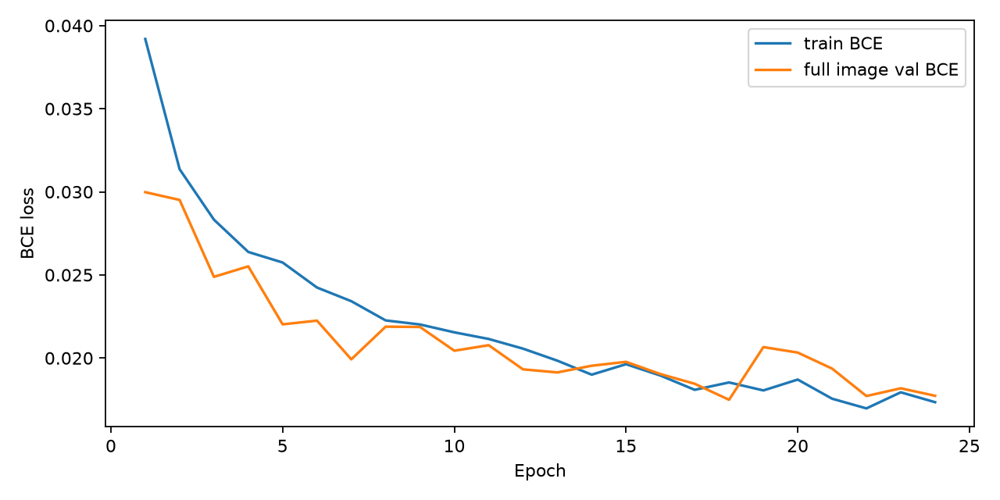
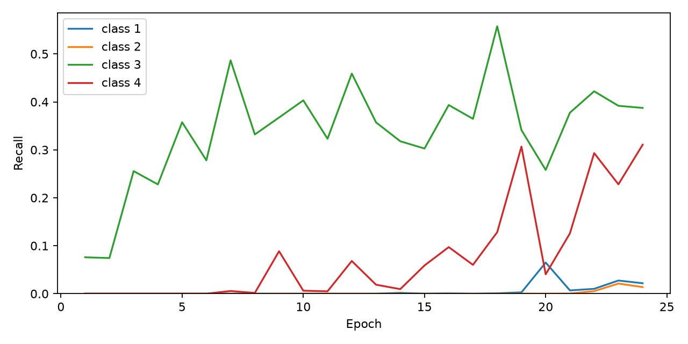

# E0 original BCE baseline

Full train and full validation manifests; official test data were not used.

Selection rule: strict improvement only; exact ties retain the earliest epoch.

| Epoch | Train BCE | Val BCE | Macro Dice | Dice 1 | Dice 2 | Dice 3 | Dice 4 | LR | Seconds |
|---:|---:|---:|---:|---:|---:|---:|---:|---:|---:|
| 1 | 0.039197 | 0.029978 | 0.034526 | 0.000000 | 0.000000 | 0.138105 | 0.000000 | 0.0003 | 2040.7 |
| 2 | 0.031362 | 0.029512 | 0.034307 | 0.000000 | 0.000000 | 0.137228 | 0.000000 | 0.0003 | 2099.3 |
| 3 | 0.028324 | 0.024885 | 0.096099 | 0.000000 | 0.000000 | 0.384397 | 0.000000 | 0.0003 | 1672.0 |
| 4 | 0.026381 | 0.025514 | 0.088994 | 0.000000 | 0.000000 | 0.355977 | 0.000000 | 0.0003 | 1579.3 |
| 5 | 0.025747 | 0.022026 | 0.123363 | 0.000000 | 0.000000 | 0.493454 | 0.000000 | 0.0003 | 1577.5 |
| 6 | 0.024242 | 0.022250 | 0.105331 | 0.000000 | 0.000000 | 0.421323 | 0.000000 | 0.0003 | 1585.1 |
| 7 | 0.023419 | 0.019922 | 0.149033 | 0.000000 | 0.000000 | 0.585054 | 0.011077 | 0.0003 | 1629.1 |
| 8 | 0.022263 | 0.021886 | 0.116537 | 0.000000 | 0.000000 | 0.463069 | 0.003077 | 0.0003 | 1651.9 |
| 9 | 0.022018 | 0.021868 | 0.161247 | 0.000000 | 0.000000 | 0.503501 | 0.141488 | 0.0003 | 1651.4 |
| 10 | 0.021545 | 0.020439 | 0.136603 | 0.000000 | 0.000000 | 0.534169 | 0.012241 | 0.0003 | 1662.0 |
| 11 | 0.021146 | 0.020771 | 0.119275 | 0.000000 | 0.000000 | 0.467191 | 0.009909 | 0.0003 | 1659.5 |
| 12 | 0.020564 | 0.019318 | 0.172829 | 0.000000 | 0.000000 | 0.569944 | 0.121370 | 0.0003 | 1814.8 |
| 13 | 0.019840 | 0.019133 | 0.133546 | 0.000000 | 0.000000 | 0.497596 | 0.036589 | 0.0003 | 1910.4 |
| 14 | 0.018998 | 0.019535 | 0.121751 | 0.003398 | 0.000000 | 0.464838 | 0.018768 | 0.0003 | 1732.1 |
| 15 | 0.019628 | 0.019771 | 0.139255 | 0.000171 | 0.000000 | 0.451187 | 0.105661 | 0.0003 | 1650.3 |
| 16 | 0.018947 | 0.019035 | 0.174282 | 0.001455 | 0.000000 | 0.529200 | 0.166473 | 0.0003 | 1643.3 |
| 17 | 0.018086 | 0.018451 | 0.155238 | 0.000000 | 0.000000 | 0.510095 | 0.110856 | 0.0003 | 1736.7 |
| 18 | 0.018530 | 0.017487 | 0.213449 | 0.001673 | 0.000000 | 0.639359 | 0.212762 | 0.0003 | 1900.1 |
| 19 | 0.018050 | 0.020659 | 0.194127 | 0.005499 | 0.000464 | 0.483959 | 0.286587 | 0.0003 | 1828.0 |
| 20 | 0.018704 | 0.020327 | 0.145991 | 0.117561 | 0.000348 | 0.389355 | 0.076701 | 0.0003 | 1640.8 |
| 21 | 0.017552 | 0.019365 | 0.188703 | 0.013563 | 0.000656 | 0.524386 | 0.216206 | 0.0003 | 1641.9 |
| 22 | 0.016969 | 0.017712 | 0.246103 | 0.020012 | 0.010550 | 0.559259 | 0.394592 | 0.0003 | 1647.9 |
| 23 | 0.017937 | 0.018178 | 0.243912 | 0.053176 | 0.041105 | 0.533970 | 0.347395 | 0.0003 | 1642.9 |
| 24 | 0.017342 | 0.017728 | 0.249202 | 0.042482 | 0.027185 | 0.519952 | 0.407189 | 0.0003 | 1637.5 |

Best val loss: epoch 18 (0.017487).
Best macro Dice: epoch 24 (0.249202).

Full precision, recall, IoU, TP/FP/FN, probability histograms, resource statistics, and per epoch examples are in metrics.jsonl and visualizations/.

