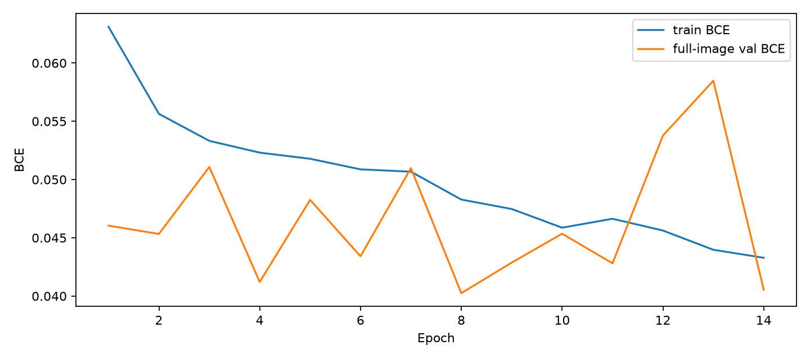
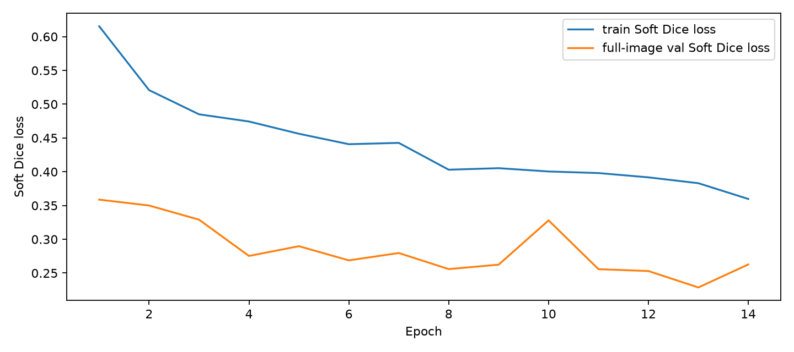
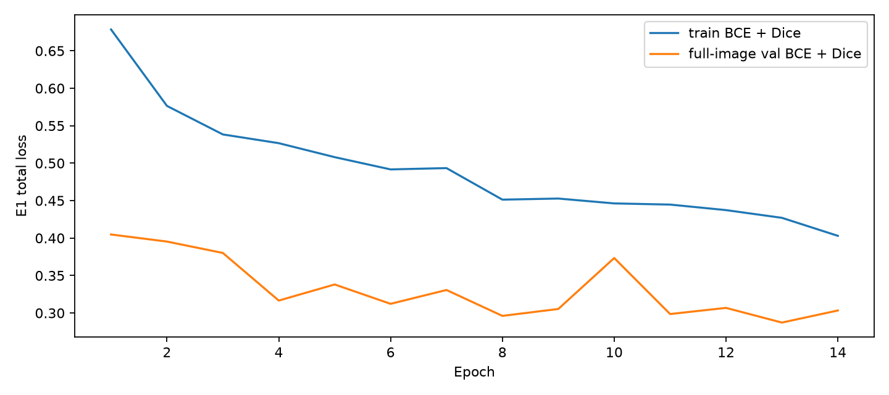
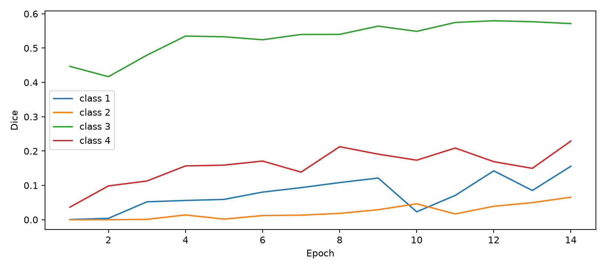
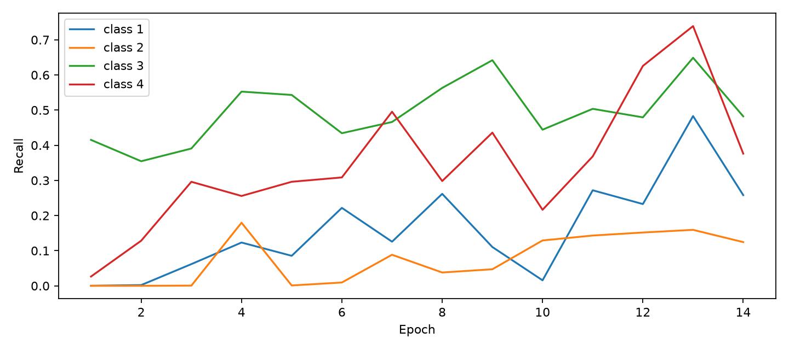

# E1 BCE + Dice formal experiment

Full frozen train and validation manifests; fixed 0.5 threshold. The independent test set was not used.

The E1 total loss has an additional Dice term and must not be compared numerically with E0 pure BCE loss.

## E1 epochs

| Epoch | Train BCE | Train Dice | Train total | Val BCE | Val Dice | Val total | Macro Dice | Seconds |
|---:|---:|---:|---:|---:|---:|---:|---:|---:|
| 1 | 0.063109 | 0.615391 | 0.678500 | 0.046044 | 0.358744 | 0.404788 | 0.121000 | 1811.4 |
| 2 | 0.055637 | 0.520822 | 0.576459 | 0.045330 | 0.350009 | 0.395340 | 0.129863 | 1902.8 |
| 3 | 0.053319 | 0.485041 | 0.538360 | 0.051080 | 0.329065 | 0.380145 | 0.161455 | 1926.0 |
| 4 | 0.052310 | 0.474394 | 0.526703 | 0.041208 | 0.275362 | 0.316570 | 0.190515 | 1876.2 |
| 5 | 0.051782 | 0.456261 | 0.508043 | 0.048254 | 0.289801 | 0.338056 | 0.188291 | 1951.5 |
| 6 | 0.050875 | 0.440799 | 0.491673 | 0.043415 | 0.268804 | 0.312219 | 0.196999 | 2445.9 |
| 7 | 0.050675 | 0.442743 | 0.493418 | 0.050982 | 0.279699 | 0.330681 | 0.196322 | 2860.0 |
| 8 | 0.048281 | 0.403022 | 0.451303 | 0.040249 | 0.255876 | 0.296125 | 0.219899 | 2889.9 |
| 9 | 0.047473 | 0.405296 | 0.452769 | 0.042873 | 0.262464 | 0.305337 | 0.226473 | 2961.0 |
| 10 | 0.045869 | 0.400409 | 0.446278 | 0.045351 | 0.328001 | 0.373352 | 0.197971 | 2515.2 |
| 11 | 0.046633 | 0.398078 | 0.444710 | 0.042810 | 0.255787 | 0.298596 | 0.217847 | 2676.1 |
| 12 | 0.045625 | 0.391702 | 0.437326 | 0.053772 | 0.253031 | 0.306803 | 0.232655 | 2461.1 |
| 13 | 0.043974 | 0.383050 | 0.427024 | 0.058482 | 0.228705 | 0.287188 | 0.215409 | 2338.4 |
| 14 | 0.043285 | 0.359716 | 0.403001 | 0.040542 | 0.262776 | 0.303318 | 0.255518 | 2128.1 |

## Checkpoint selection

Best validation BCE: epoch 8 (0.040249).
Best validation total loss: epoch 13 (0.287188).
Best macro Dice: epoch 14 (0.255518).
Strict improvement selects a new checkpoint; exact ties retain the earlier epoch. Early Stopping monitors only full-image validation BCE.

## Matched validation comparison

Both rows use full validation images, whole-set TP/FP/FN, and threshold 0.5. E0 refers to its prespecified epoch 24 best-macro checkpoint; E1 refers to its best-macro checkpoint.

| Metric | E0 epoch 24 | E1 best macro |
|---|---:|---:|
| Macro Dice | 0.249202 | 0.255518 |
| Dice class 1 | 0.042482 | 0.155742 |
| Dice class 2 | 0.027185 | 0.065606 |
| Dice class 3 | 0.519952 | 0.571518 |
| Dice class 4 | 0.407189 | 0.229206 |
| Recall class 1 | 0.021781 | 0.258122 |
| Recall class 2 | 0.013787 | 0.124405 |
| Recall class 3 | 0.387413 | 0.482263 |
| Recall class 4 | 0.310627 | 0.376209 |
| Precision class 1 | 0.855730 | 0.111512 |
| Precision class 2 | 0.961590 | 0.044549 |
| Precision class 3 | 0.790338 | 0.701313 |
| Precision class 4 | 0.590864 | 0.164808 |
| Normal-image false-positive rate | 0.340113 | 0.702825 |
| Full-background prediction ratio | 0.351940 | 0.170122 |
| Actual epochs | 24 | 14 |
| Total epoch hours | 11.454 | 9.095 |

## Curves

Full per-class IoU, predicted-positive-pixel ratios, probability histograms, resource readings, and representative TP/FP/FN visualizations are in metrics.jsonl and visualizations/.
