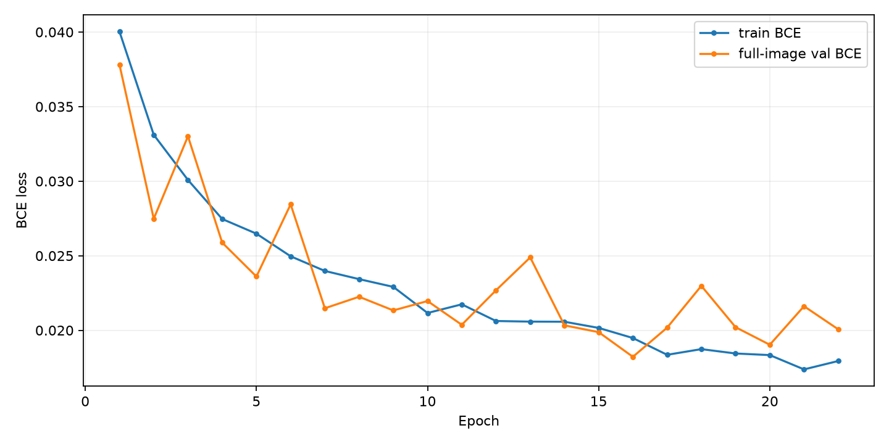
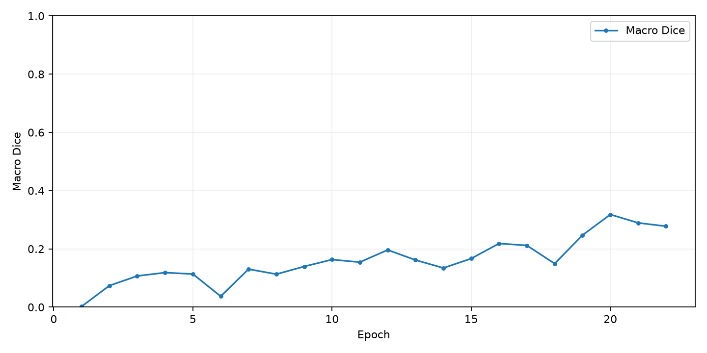
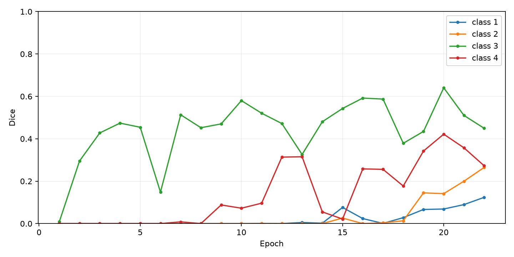
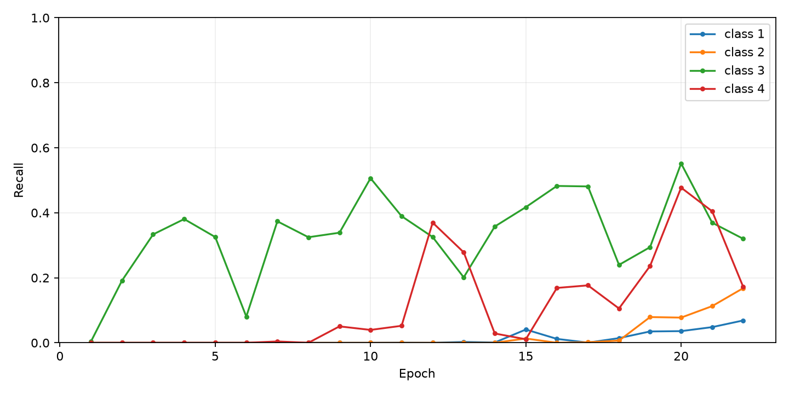
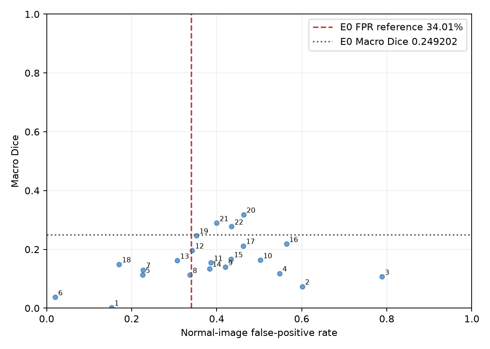
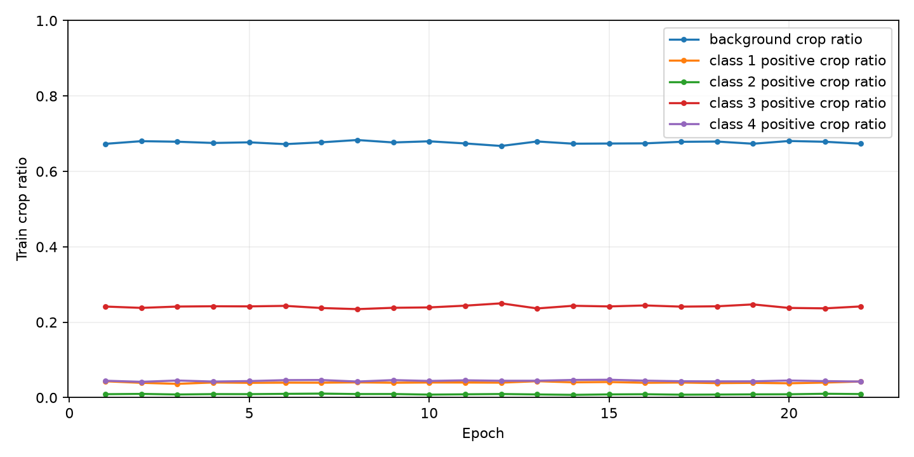

# E2 类别感知采样正式训练：验证集结果与 E0/E1 对照

训练从完整 E2 Epoch 1 checkpoint 恢复，随后从 Epoch 2 开始；没有重复计算 Epoch 1。总训练 22 epochs，在完整验证 BCE 连续 6 轮未改善后于 Epoch 22 Early Stop。未读取独立 test 集；test manifest 仅用于哈希核对。所有模型性能均为冻结验证集 validation 结果，阈值固定 0.50。

E0/E1/E2 对照使用相同完整验证清单、整图拼接、全验证集 TP/FP/FN 累计和阈值 0.50。E0 采用指定 Epoch 24，E1 采用指定 Epoch 14，E2 主结果采用验证 Macro Dice 最大的 epoch。E2 的验证集结果不能当作独立测试或泛化性能。

## 主要判断

E2 best-macro checkpoint 为 Epoch 20：Macro Dice 0.318016，正常图误检率 46.33%。它超过 E0 的 Macro Dice 0.249202，但 FPR 高于 34.01% 约束，因此**没有满足联合目标**。
在正常图 FPR ≤34.01% 的 E2 epoch 中，最高 Macro Dice 是 Epoch 13：0.161653，FPR 30.73%；低于 E0 的 0.249202。故 E2 也未在误检约束内胜过 E0。
因此按预先设定的判断标准，E0 保留为最终候选。E2 的高 Macro Dice 候选伴随较高正常图误检，不能描述为全面提升。此处不追加新实验。

## E0 / E1 / E2 指标对照

| 模型/验证 checkpoint | Epoch | Macro Dice | 正常图误检率 | 全背景预测率 |
|---|---:|---:|---:|---:|
| E0 Epoch 24 best macro | 24 | 0.249202 | 34.01% | 35.19% |
| E1 Epoch 14 best macro | 14 | 0.255518 | 70.28% | 17.01% |
| E2 Epoch 20 best macro | 20 | 0.318016 | 46.33% | 29.56% |
| E2 Epoch 13 best under FPR limit | 13 | 0.161653 | 30.73% | 42.42% |

| 类别 | 指标 | E0 Epoch 24 | E1 Epoch 14 | E2 best Macro Epoch 20 |
|---:|---|---:|---:|---:|
| 1 | Dice | 0.042482 | 0.155742 | 0.068746 |
| 1 | IoU | 0.021702 | 0.084447 | 0.035596 |
| 1 | Precision | 0.855730 | 0.111512 | 0.840183 |
| 1 | Recall | 0.021781 | 0.258122 | 0.035839 |
| 2 | Dice | 0.027185 | 0.065606 | 0.141166 |
| 2 | IoU | 0.013780 | 0.033915 | 0.075943 |
| 2 | Precision | 0.961590 | 0.044549 | 0.797274 |
| 2 | Recall | 0.013787 | 0.124405 | 0.077439 |
| 3 | Dice | 0.519952 | 0.571518 | 0.640397 |
| 3 | IoU | 0.351308 | 0.400087 | 0.471017 |
| 3 | Precision | 0.790338 | 0.701313 | 0.762903 |
| 3 | Recall | 0.387413 | 0.482263 | 0.551791 |
| 4 | Dice | 0.407189 | 0.229206 | 0.421756 |
| 4 | IoU | 0.255641 | 0.129437 | 0.267231 |
| 4 | Precision | 0.590864 | 0.164808 | 0.377769 |
| 4 | Recall | 0.310627 | 0.376209 | 0.477336 |

## E2 逐 Epoch 记录

| Epoch | Train BCE | Val BCE | Macro Dice | Dice 1/2/3/4 | Recall 1/2/3/4 | Normal FPR | All-bg ratio | Train bg crop | Stale | Seconds |
|---:|---:|---:|---:|---|---|---:|---:|---:|---:|---:|
| 1 | 0.040026 | 0.037801 | 0.002096 | 0.000/0.000/0.008/0.000 | 0.000/0.000/0.004/0.000 | 15.25% | 80.54% | 67.31% | 0 | 2019.5 |
| 2 | 0.033111 | 0.027479 | 0.073806 | 0.000/0.000/0.295/0.000 | 0.000/0.000/0.192/0.000 | 60.11% | 28.81% | 68.02% | 0 | 1889.6 |
| 3 | 0.030081 | 0.033012 | 0.106873 | 0.000/0.000/0.427/0.000 | 0.000/0.000/0.333/0.000 | 78.87% | 17.17% | 67.87% | 1 | 1780.2 |
| 4 | 0.027464 | 0.025880 | 0.118470 | 0.000/0.000/0.474/0.000 | 0.000/0.000/0.381/0.000 | 54.80% | 34.45% | 67.54% | 0 | 1677.2 |
| 5 | 0.026480 | 0.023604 | 0.113600 | 0.000/0.000/0.454/0.000 | 0.000/0.000/0.325/0.000 | 22.60% | 57.52% | 67.71% | 0 | 1660.3 |
| 6 | 0.024962 | 0.028448 | 0.037093 | 0.000/0.000/0.148/0.000 | 0.000/0.000/0.080/0.000 | 2.03% | 76.87% | 67.23% | 1 | 1635.7 |
| 7 | 0.023979 | 0.021477 | 0.130348 | 0.000/0.000/0.513/0.008 | 0.000/0.000/0.374/0.004 | 22.71% | 54.12% | 67.71% | 0 | 1645.5 |
| 8 | 0.023431 | 0.022248 | 0.113067 | 0.000/0.000/0.452/0.000 | 0.000/0.000/0.325/0.000 | 33.67% | 43.49% | 68.32% | 1 | 1636.7 |
| 9 | 0.022911 | 0.021332 | 0.139523 | 0.000/0.000/0.470/0.088 | 0.000/0.000/0.339/0.050 | 42.03% | 39.55% | 67.68% | 0 | 1668.3 |
| 10 | 0.021160 | 0.021962 | 0.163153 | 0.000/0.000/0.580/0.073 | 0.000/0.000/0.506/0.040 | 50.28% | 32.32% | 67.98% | 1 | 1636.9 |
| 11 | 0.021741 | 0.020368 | 0.154340 | 0.001/0.000/0.521/0.096 | 0.000/0.000/0.390/0.052 | 38.64% | 37.32% | 67.41% | 0 | 1645.4 |
| 12 | 0.020623 | 0.022682 | 0.196387 | 0.000/0.000/0.472/0.314 | 0.000/0.000/0.325/0.370 | 34.24% | 43.49% | 66.74% | 1 | 1628.7 |
| 13 | 0.020581 | 0.024887 | 0.161653 | 0.005/0.000/0.326/0.315 | 0.003/0.000/0.201/0.278 | 30.73% | 42.42% | 67.94% | 2 | 1629.7 |
| 14 | 0.020573 | 0.020331 | 0.134347 | 0.002/0.000/0.480/0.055 | 0.001/0.000/0.358/0.029 | 38.31% | 37.00% | 67.35% | 0 | 1650.6 |
| 15 | 0.020160 | 0.019875 | 0.166628 | 0.076/0.026/0.543/0.021 | 0.041/0.013/0.417/0.011 | 43.39% | 31.74% | 67.39% | 0 | 1634.0 |
| 16 | 0.019481 | 0.018221 | 0.218425 | 0.024/0.000/0.592/0.258 | 0.012/0.000/0.483/0.169 | 56.38% | 24.99% | 67.44% | 0 | 1645.9 |
| 17 | 0.018356 | 0.020177 | 0.211888 | 0.001/0.003/0.587/0.256 | 0.000/0.002/0.481/0.177 | 46.21% | 32.48% | 67.85% | 1 | 1621.9 |
| 18 | 0.018736 | 0.022981 | 0.149292 | 0.028/0.013/0.379/0.177 | 0.014/0.007/0.240/0.105 | 17.06% | 53.00% | 67.91% | 2 | 1728.5 |
| 19 | 0.018444 | 0.020208 | 0.247125 | 0.067/0.145/0.435/0.342 | 0.035/0.079/0.294/0.236 | 35.25% | 36.10% | 67.33% | 3 | 1682.5 |
| 20 | 0.018336 | 0.019030 | 0.318016 | 0.069/0.141/0.640/0.422 | 0.036/0.077/0.552/0.477 | 46.33% | 29.56% | 68.06% | 4 | 1717.4 |
| 21 | 0.017378 | 0.021614 | 0.289243 | 0.090/0.200/0.510/0.357 | 0.048/0.113/0.369/0.405 | 40.00% | 34.61% | 67.86% | 5 | 1663.3 |
| 22 | 0.017940 | 0.020065 | 0.277693 | 0.124/0.265/0.449/0.273 | 0.069/0.168/0.320/0.172 | 43.50% | 29.29% | 67.35% | 6 | 1665.4 |

## Checkpoint 与资源

- Best validation BCE：Epoch 16，Val BCE 0.018221。
- Best Macro Dice：Epoch 20，Macro Dice 0.318016。
- 实际完成：22 epochs / 30 上限；Early Stopping 于 Epoch 22 触发。
- 累计 epoch 训练+验证耗时：10.32 小时（不含进程启动等外围时间）。
- Checkpoint 核验 epoch：`best_val_loss.pt`=16，`best_macro_dice.pt`=20，`last.pt`=22；三者均可加载，manifest 哈希匹配。
- Checkpoint 中保留模型、optimizer、scheduler、RNG、采样计划、Early Stopping 状态和冻结 manifest hashes。
- 全量 per-class 指标、TP/FP/FN、采样比例、耗时、MPS 内存、典型漏检/误检记录见 `epoch1/metrics.jsonl`；日志见 `epoch1/run.log`。

## 错误与采样分析

E2 Macro Dice 随 epoch 变化并伴随正常图 FPR 波动：最佳 Macro Dice Epoch 20 的 FPR 为 46.33%；最优 BCE 在 Epoch 16。两者优化口径不同。少数类召回虽随训练出现，但类别 1/2 仍是主要短板；不能只凭 Macro Dice 或仅凭 FPR 宣称整体胜出。实际采样分布每轮记录于 metrics.jsonl，候选 tile 频率不等于实际裁剪后 Mask 类别比例。

## 曲线

## 最终决定

E2 未在正常图误检率 ≤34.01% 时超过 E0 的 Macro Dice 0.249202。按要求保留 E0 为最终候选；不运行独立测试、不部署，也不自动启动额外实验。
