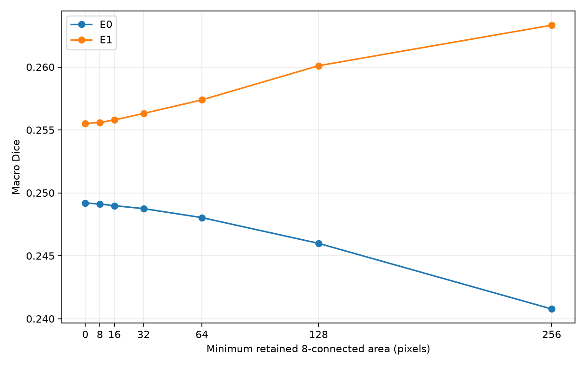
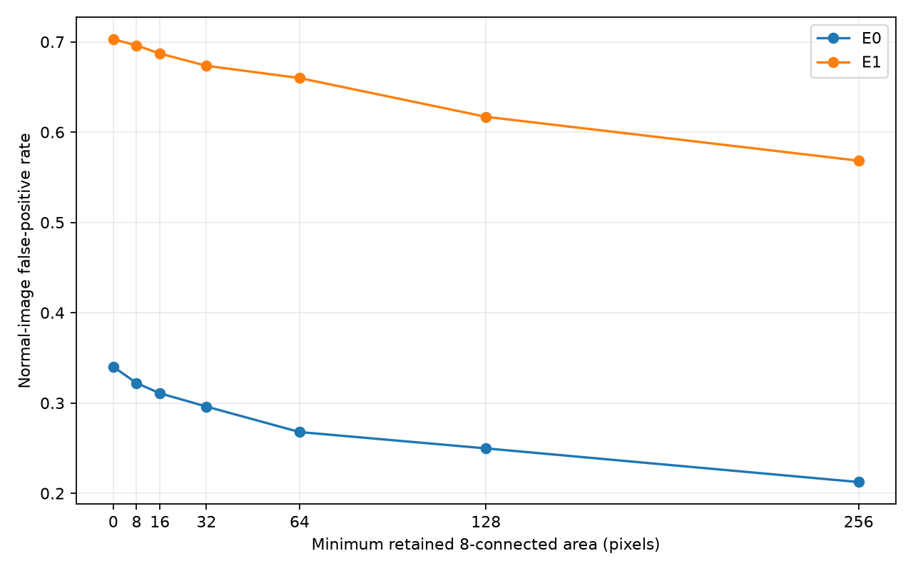
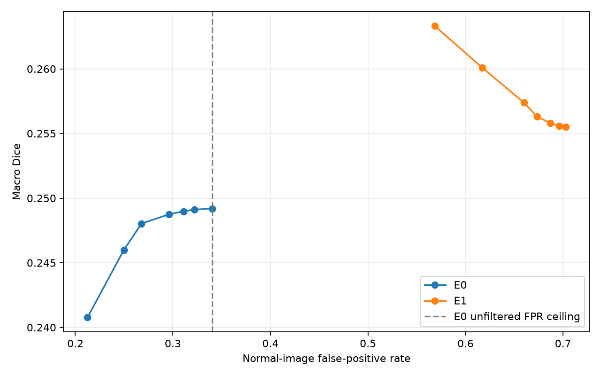
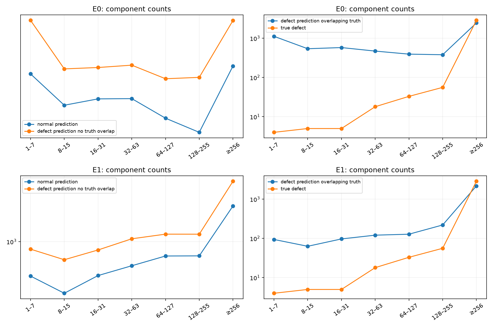

# E0/E1 8-connected area filtering

validation-tuned; full frozen 1881-image validation only; no test set read

Prediction uses 0.50 after overlap-averaged full-image logits. Areas are per-class and regions smaller than the threshold are removed. TP/FP/FN are recounted from each filtered full-image mask.

E0 unfiltered normal-image FPR ceiling: 0.340113.

| Model | Min area | Macro Dice | Normal-image FPR | Class 1/2/3/4 Dice | Class 1/2/3/4 Recall | Removed pixels | Removed components |
|---|---:|---:|---:|---|---|---:|---:|
| E0 | 0 | 0.249202 | 0.340113 | 0.0425/0.0272/0.5200/0.4072 | 0.0218/0.0138/0.3874/0.3106 | 0 | 0 |
| E0 | 8 | 0.249113 | 0.322034 | 0.0424/0.0271/0.5198/0.4071 | 0.0217/0.0137/0.3873/0.3104 | 7968 | 2315 |
| E0 | 16 | 0.248982 | 0.310734 | 0.0423/0.0269/0.5197/0.4071 | 0.0217/0.0136/0.3871/0.3101 | 21225 | 3514 |
| E0 | 32 | 0.248749 | 0.296045 | 0.0418/0.0269/0.5193/0.4070 | 0.0214/0.0136/0.3866/0.3094 | 50123 | 4782 |
| E0 | 64 | 0.248034 | 0.267797 | 0.0396/0.0269/0.5188/0.4068 | 0.0202/0.0136/0.3859/0.3080 | 103798 | 5957 |
| E0 | 128 | 0.245989 | 0.249718 | 0.0359/0.0234/0.5180/0.4067 | 0.0183/0.0119/0.3848/0.3058 | 190749 | 6915 |
| E0 | 256 | 0.240774 | 0.212429 | 0.0218/0.0178/0.5164/0.4071 | 0.0110/0.0090/0.3824/0.3028 | 360147 | 7829 |
| E1 | 0 | 0.255518 | 0.702825 | 0.1557/0.0656/0.5715/0.2292 | 0.2581/0.1244/0.4823/0.3762 | 0 | 0 |
| E1 | 8 | 0.255594 | 0.696045 | 0.1558/0.0659/0.5715/0.2292 | 0.2580/0.1242/0.4823/0.3762 | 5584 | 1456 |
| E1 | 16 | 0.255794 | 0.687006 | 0.1559/0.0665/0.5715/0.2293 | 0.2580/0.1238/0.4822/0.3761 | 18179 | 2571 |
| E1 | 32 | 0.256312 | 0.673446 | 0.1561/0.0682/0.5715/0.2294 | 0.2577/0.1232/0.4822/0.3760 | 51256 | 4021 |
| E1 | 64 | 0.257390 | 0.659887 | 0.1570/0.0713/0.5715/0.2297 | 0.2571/0.1215/0.4820/0.3755 | 133751 | 5817 |
| E1 | 128 | 0.260103 | 0.616949 | 0.1588/0.0795/0.5716/0.2305 | 0.2542/0.1192/0.4818/0.3745 | 322215 | 7856 |
| E1 | 256 | 0.263326 | 0.568362 | 0.1617/0.0884/0.5715/0.2317 | 0.2447/0.1038/0.4809/0.3717 | 715033 | 9988 |

## Selection under original E0 false-positive constraint

Best feasible validation-tuned row: E0 area 0, Macro Dice 0.249202, normal-image FPR 0.340113.

## Error diagnosis and interpretation

- E0: normal images contain 1974 false-positive components; 383 (19.4%) have area <8 and 1546 (78.3%) have area <256. At area 256, normal-image FPR changes 34.0%→21.2%, Macro Dice 0.2492→0.2408, class-1 Recall 0.0218→0.0110, and class-2 Recall 0.0138→0.0090.
- E1: normal images contain 5524 false-positive components; 502 (9.1%) have area <8 and 3484 (63.1%) have area <256. At area 256, normal-image FPR changes 70.3%→56.8%, Macro Dice 0.2555→0.2633, class-1 Recall 0.2581→0.2447, and class-2 Recall 0.1244→0.1038.
- Ground-truth defect components: 121/2980 (4.1%) have area <256. This does **not** make filtering harmless: predicted components may fragment a larger true defect, and the measured class-1/2 Recall decreases confirm removed true-positive pixels. In images containing defects, not every predicted component is correct; the JSON separates predicted components with and without any overlap with the class-specific truth.
- E1 retains many large false-positive regions: 2040 normal-image predicted components have area ≥256. Thus the false alarms are not predominantly tiny specks that the tested filters can completely remove.
- Within the requested FPR ceiling, E0 is the practical choice. E1 has slightly higher Macro Dice throughout this area grid but much higher normal-image FPR; neither model dominates both axes, so a same-FPR ranking cannot be extrapolated outside this grid.

## Recommendation

Keep E0 at 0.50 with no area filter if the goal is to maximize Macro Dice under the original 34.01% FPR ceiling. A small area filter can lower E0 false alarms if a stricter FPR is required, but did not improve its Macro Dice. E1's area-256 result modestly improves Dice yet remains far above the FPR ceiling. Given persistent large false-positive components and poor class-1/2 Recall, a separately controlled E2 training study (class weighting **or** defect-aware sampling, one change at a time) is more promising than a large class-specific area-threshold search. Freeze its policy on validation before opening the independent test set.

This selection is validation-tuned, not an independent test result. Class-specific area combinations were not searched.

## Figures and cases

Component distributions are also in `e0_area_distributions.json` and `e1_area_distributions.json`. Representative full-image errors are indexed by `case_index.json`.
