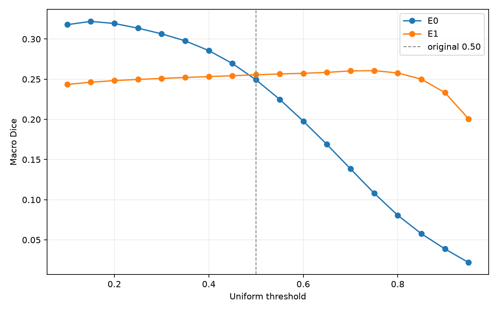
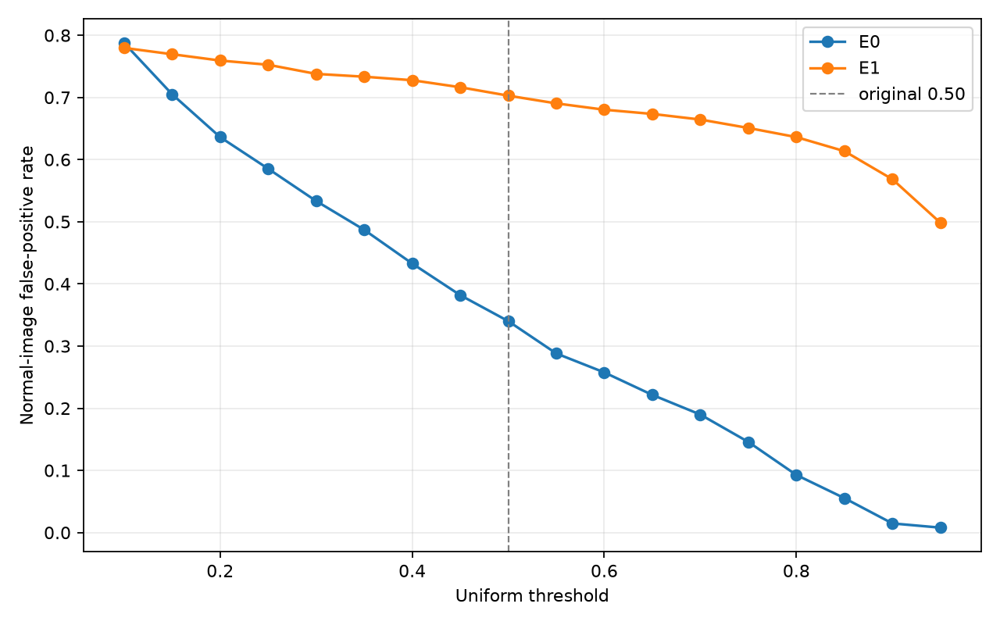
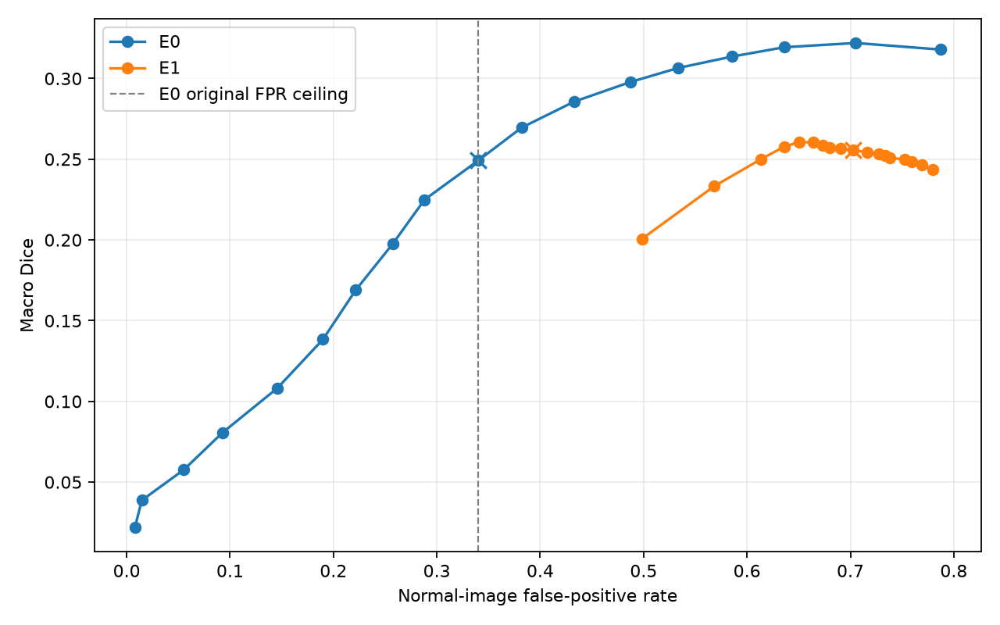

# E0/E1 uniform threshold analysis

validation-tuned; frozen 1881-image validation only; no test images read

Sigmoid follows full-image overlap-averaged logits. All confusion counts are accumulated over the entire validation set. The 0.50 rows reproduce the formal evaluations.

E0 original 0.50 normal-image FPR ceiling: 0.340113.

| Model | Threshold | Macro Dice | Normal-image FPR | Full-background ratio | Class 1/2/3/4 Dice |
|---|---:|---:|---:|---:|---|
| E0 original | 0.50 | 0.249202 | 0.340113 | 0.351940 | 0.0425/0.0272/0.5200/0.4072 |
| E1 original | 0.50 | 0.255518 | 0.702825 | 0.170122 | 0.1557/0.0656/0.5715/0.2292 |
| E0 validation-tuned, feasible | 0.50 | 0.249202 | 0.340113 | 0.351940 | 0.0425/0.0272/0.5200/0.4072 |

The constraint is **normal-image FPR ≤ 0.340113**, the original E0 result (301/885 normal validation images). Among all 36 scanned model/threshold combinations, the largest feasible Macro Dice is the unchanged **E0 at 0.50**. E1 has **no feasible threshold** in the 0.10–0.95 grid: even at 0.95 its normal-image FPR is 0.498305. Thus this uniform-threshold scan does not establish an improvement under the requested false-positive constraint.

Without that constraint, E0 peaks at threshold 0.15 with Macro Dice 0.321991 but normal-image FPR 0.705085; E1 peaks at 0.75 with Macro Dice 0.260683 and FPR 0.650847. These are diagnostic, **validation-tuned** operating points, not independent test results or recommended replacements for the constrained baseline.

## Per-class behavior and errors

- **Class 1:** E0 Dice falls from 0.1776 at 0.15 to 0.0425 at 0.50 as recall falls from 0.111 to 0.022. E1 Dice is 0.1557 at 0.50 and 0.1610 at 0.75, but precision remains low (0.112 and 0.121), contributing to false alarms.
- **Class 2:** E0 Dice falls from 0.1199 at 0.15 to 0.0272 at 0.50; its 0.50 recall is only 0.0138. E1 reaches Dice 0.0697 at 0.75, but precision is only 0.062 and normal-image false alarms remain above the ceiling.
- **Class 3:** E0 peaks near 0.15 (Dice 0.6224) but with high normal-image FPR. E1 Dice declines from 0.5715 at 0.50 to 0.5643 at 0.75. Raising thresholds increases precision but loses recall for both models.
- **Class 4:** E0 improves from Dice 0.4072 at 0.50 to 0.4521 at 0.30, but FPR rises to 0.5333. E1 improves modestly from 0.2292 at 0.50 to 0.2477 at 0.75, still far below E0 0.50.

Representative **false-positive and false-negative original images** for E0 at 0.50 and 0.15, and E1 at 0.50 and 0.75, are in `cases/` and indexed by `case_index.json`. Each image shows the original, true-mask overlay (green), predicted-mask overlay (red), and probability heatmap. The case selector uses the largest class-specific error-pixel count; a normal-image false positive is also saved per operating point when present. This is diagnostic sampling, not a prevalence estimate.

## Recommendation

**Keep E0 at the original 0.50 threshold** for now under the stated false-positive constraint. Uniform threshold adjustment alone cannot make E1 meet that constraint on validation, and lowering E0 to improve Dice substantially raises normal-image false positives. A separately controlled postprocessing study (for example, minimum connected-component area) is the next low-cost diagnostic; if false alarms persist, design an E2 training experiment with explicit controls and keep the independent test set sealed until a validation policy is frozen. Do not treat E1's unconstrained Dice peak as evidence of deployment improvement.

Selection uses validation only and is not an independent test estimate. Uniform thresholds are the only tuned parameter here; no class-specific thresholds, postprocessing or training were used.

## Curves

Complete class-wise Dice, IoU, Precision, Recall and TP/FP/FN are in threshold_metrics.csv; representative cases are indexed in case_index.json.
